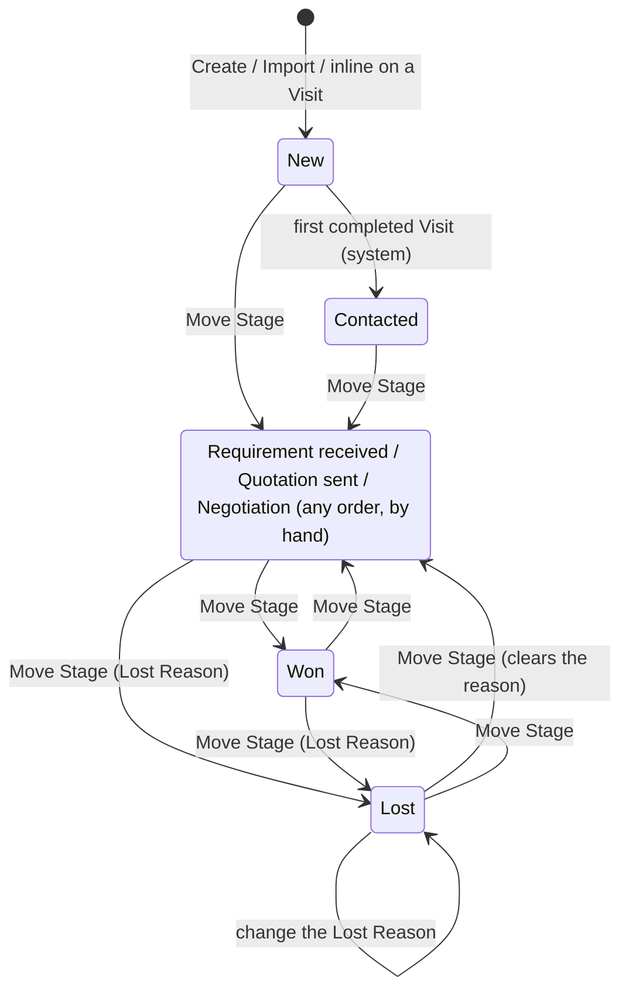
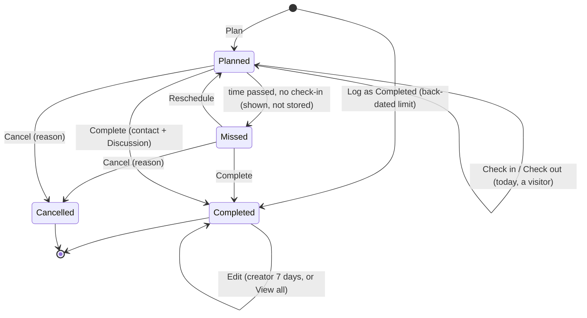
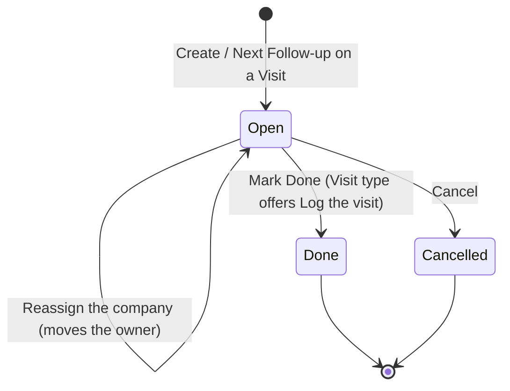

# 14 — Marketing (Prospect Companies, Visits and Follow-ups)

Marketing is the register of the marketing team's work to win construction contracts. A Marketing Person visits a **Prospect Company**, meets its **Contacts**, logs a **Visit** with what was discussed, photos and files, and owes **Follow-ups** after it. The company moves through fixed **Stages** until it is Won (and becomes a Project's client) or Lost. A **Dashboard**, a **Team** page with monthly visit targets, and three **Reports** show how the team is doing.

It is a Company-level main-menu area, not a Project module, and it is not the Sales CRM: Inquiries and Bookings (module 09) sell a Project's units to buyers, while Marketing is the contractor's business development with other companies. "Lead", "Inquiry" and "Booking" stay Sales CRM words and are not used here.

Who uses it:

| Actor                                                                                                     | What they do                                                                                                                                                             |
| --------------------------------------------------------------------------------------------------------- | ------------------------------------------------------------------------------------------------------------------------------------------------------------------------ |
| **Marketing Person** (Office Staff on the default Marketing Role, or the Owner)                           | Adds Prospect Companies and Contacts, plans and logs Visits, checks in at the site, adds notes, photos and files, works through their Follow-ups; sees only their own    |
| Marketing manager (a Role the Owner duplicates from Marketing and gives View all, Transfer, Delete, Team) | Sees the team's Visits, Follow-ups, Companies and Dashboard figures, sets visit targets, reassigns companies, edits locked Visits, deletes, exports, imports and reports |
| Owner / Admin                                                                                             | Everything; adds Marketing People under Human Resources → Staff                                                                                                          |

Read with: [PRD — Marketing](../prd/marketing.md) (what the owner asked for), [ADR CM-0040](../adr/CM-0040-marketing-context-role-and-own-entries.md) (how it fits the product, with what each ticket settled as built), and the Marketing section of [e2e-tests.md](../e2e-tests.md#marketing). The code is in `src/marketing/` (domain, application, infrastructure), `src/composition/marketing-*.ts`, routes under `app/api/construction/marketing/`, screens under `app/app/marketing/`, and the reports in `src/reporting/domain/marketing-reports.ts` and `src/reporting/application/build-marketing-report.ts`.

---

## Legacy behaviour

The legacy BuildControl has **no Marketing module**. Its only selling features are the per-Project Inquiry and Booking tiles (module 09), and two seeded designations, Marketing Executive and Marketing Manager, that are used for them. Nothing in the legacy tracks visits to other companies.

Marketing is new, asked for by the owner on 2026-11-12 (PRD, opening):

1. A new main-menu item, **Marketing**.
2. A new system Role, **Marketing**.
3. A **Dashboard** and **Visit Details**: who from the marketing team is visiting, the date, the company visited, the point of contact there, and other details.
4. On each visit: notes, photos and follow-up updates.
5. The marketing people themselves managed from this menu.

The client is a civil and steel-fabrication contractor whose marketing people visit companies to win construction contracts. The PRD records the request and the additions agreed in review (PRD §7).

### Screens (as built)

| Screen                      | Address                                               | Main actions                                                                                                                     |
| --------------------------- | ----------------------------------------------------- | -------------------------------------------------------------------------------------------------------------------------------- |
| Marketing Dashboard         | `/app/marketing`                                      | Period switch, person filter (View all), totals, Today, per person, Stages, Visits over time, Recent activity, Hot companies     |
| Visits — list               | `/app/marketing/visits`                               | Filters (dates, person, company, status, purpose, interest), New Visit, Log a Visit, Export; `?memberId=` from a Team row        |
| Visits — calendar           | `/app/marketing/visits?view=calendar[&calendar=week]` | Month and week; Check in from today's Visit                                                                                      |
| New Visit / Log a Visit     | `/app/marketing/visits/new[?status=completed]`        | Pick or add the company and Contacts inline; `&prospectCompanyId=&contactIds=&visitorIds=` from Log the visit                    |
| Visit                       | `/app/marketing/visits/{id}`                          | Complete, Reschedule, Cancel, Edit, Delete, Check in / Check out, notes, photos and files, Follow-ups, History                   |
| Complete a Visit            | `/app/marketing/visits/{id}/complete`                 | Points of contact, Discussion, outcome, interest, requirement, Next Follow-up                                                    |
| Edit a Visit                | `/app/marketing/visits/{id}/edit`                     | Details; the time only on a Completed Visit                                                                                      |
| Follow-ups                  | `/app/marketing/follow-ups`                           | Mine / everyone's (View all), owner filter (`?owner=`), Overdue · Today · Upcoming, add, edit, Done (then Log the visit), Cancel |
| Companies — list            | `/app/marketing/companies`                            | Search, filters (Stage, assigned person, industry), New, Import, Export                                                          |
| New / edit Prospect Company | `/app/marketing/companies/new`, `…/{id}/edit`         | Company details and a first Contact                                                                                              |
| Prospect Company            | `/app/marketing/companies/{id}`                       | Contacts, Move Stage, Reassign, Delete, Create Project (Won), Projects, timeline                                                 |
| Needs reassigning           | `/app/marketing/companies/needs-reassigning`          | Companies and Open Follow-ups of people who left; Reassign                                                                       |
| Team                        | `/app/marketing/team`                                 | Visits this month against target, set target, Add Marketing Person, links to a person's Visits and Follow-ups                    |
| Reports                     | `/app/marketing/reports`                              | Visit register, Marketing Person summary, Company pipeline                                                                       |

---

## Entities & fields

Postgres schema `construction_marketing`, Prisma file `packages/db/construction/prisma/schema/construction-marketing.prisma`, models prefixed `ConstructionMarketing`, API prefix `/api/construction/marketing` (ADR CM-0040 §6). Every table has `workspace_id` so the Company purge finds it. Team Members live in the organization schema: `*_member_id` columns are their ids with no foreign key; `created_by` / `updated_by` / `deleted_by` are user ids. Deletes are tombstones (`deleted_at`, `deleted_by`).

Migrations: `20261112090000_construction_organization_marketing_role` (the Role and Admin's cells), `…100000_construction_marketing` (companies, Contacts, Stage changes), `…110000_…_visits`, `…120000_…_visit_files`, `…130000_…_follow_ups`, `…140000_…_visit_check_in`, `…150000_…_visit_targets`, and `20261113100000_construction_reporting_marketing_reports` (the report kinds).

### Prospect Company (`prospect_companies`)

| Field                              | Type                                                                                    | Required | Notes                                                                                                                     |
| ---------------------------------- | --------------------------------------------------------------------------------------- | -------- | ------------------------------------------------------------------------------------------------------------------------- |
| id                                 | uuid                                                                                    | yes      |                                                                                                                           |
| name                               | text, ≤ 120                                                                             | yes      | Spaces collapsed                                                                                                          |
| name_key                           | text                                                                                    | yes      | Lower case, spaces collapsed; partial unique on live rows of the Company                                                  |
| industry                           | text, ≤ 60                                                                              | no       | Free text; the form suggests the industries already typed                                                                 |
| address                            | text, ≤ 500                                                                             | no       | Line breaks kept                                                                                                          |
| city                               | text, ≤ 60                                                                              | no       |                                                                                                                           |
| state_code                         | GST state code                                                                          | no       | Picked from a list; set from the GSTIN's first two digits when there is one                                               |
| pin                                | six digits                                                                              | no       |                                                                                                                           |
| phone                              | text, ≤ 20                                                                              | no       | As typed: an office line or a mobile, at least six digits                                                                 |
| email, website                     | text                                                                                    | no       | Format checked; website ≤ 200                                                                                             |
| gstin                              | 15 characters                                                                           | no       | Upper case, checksum checked (tax-ids kernel); must match the chosen state                                                |
| source                             | enum: Reference, Cold call, Tender notice, Existing client, Exhibition, Online, Other   | no       |                                                                                                                           |
| assigned_member_id                 | Team Member id                                                                          | no       | The Marketing Person chasing it; the creator when they are an active Marketing Person, else empty. Moves only by Reassign |
| stage                              | enum: New, Contacted, Requirement received, Quotation sent, Negotiation, Won, Lost      | yes      | New on creation                                                                                                           |
| lost_reason, lost_reason_text      | enum: Price, Went to a competitor, No requirement now, Not reachable, Other; text ≤ 300 | if Lost  | Text only with Other                                                                                                      |
| remarks                            | text, ≤ 1000                                                                            | no       |                                                                                                                           |
| created / updated / deleted stamps |                                                                                         |          |                                                                                                                           |

### Contact (`contacts`)

| Field           | Type         | Required | Notes                                                              |
| --------------- | ------------ | -------- | ------------------------------------------------------------------ |
| prospectCompany | FK           | yes      |                                                                    |
| name            | text, ≤ 120  | yes      |                                                                    |
| job_title       | text, ≤ 80   | no       |                                                                    |
| mobile          | E.164        | no       | Ten digits become `+91…`; any other must be `+` and 8–15 digits    |
| email           | text         | no       |                                                                    |
| remarks         | text, ≤ 1000 | no       |                                                                    |
| is_primary      | boolean      | yes      | Partial unique: one live primary per company; the first is primary |

### Stage change (`stage_changes`)

Append-only: `from_stage` (null on the company's first row, its creation at New), `to_stage`, Lost Reason and its text, `changed_at`, `changed_by`.

### Visit (`visits`) and its rows

| Field                                                              | Type                                                                                                                  | Required       | Notes                                                        |
| ------------------------------------------------------------------ | --------------------------------------------------------------------------------------------------------------------- | -------------- | ------------------------------------------------------------ |
| number, sequence                                                   | `MV-0001`                                                                                                             | yes            | Sequence module `marketing_visit`; unique per Company        |
| prospectCompany                                                    | FK                                                                                                                    | yes            | Picked, or added inline                                      |
| visit_at                                                           | instant                                                                                                               | yes            | Entered and shown in the Company time zone                   |
| status                                                             | enum: Planned, Completed, Cancelled                                                                                   | yes            | Missed is worked out, never stored                           |
| purpose                                                            | enum: Cold call, Introduction, Requirement discussion, Quotation, Negotiation, Relationship, Payment follow-up, Other | no             |                                                              |
| location                                                           | text, ≤ 300                                                                                                           | no             | Starts as the company's address and city                     |
| discussion                                                         | text, ≤ 4000                                                                                                          | to complete    |                                                              |
| outcome                                                            | text, ≤ 300                                                                                                           | no             |                                                              |
| interest                                                           | enum: Hot, Warm, Cold                                                                                                 | no             |                                                              |
| requirement_work_type                                              | enum: Civil, PEB, Steel fabrication, Shed erection, Other                                                             | no             |                                                              |
| requirement_value                                                  | whole rupees                                                                                                          | no             | 0 to ₹10,000 crore; shown to everyone who can read the Visit |
| requirement_start_month                                            | month                                                                                                                 | no             | Stored as its first day                                      |
| completed_at, completed_by                                         |                                                                                                                       | when Completed | The edit lock counts from `completed_at`                     |
| check_in_at / _by / _latitude / _longitude / _accuracy / _location | instant, user, floats (metres), enum: recorded, refused, unavailable                                                  | no             | One reading; the same six for check-out                      |
| cancel_reason, cancelled_at, cancelled_by                          | text ≤ 300                                                                                                            | when Cancelled |                                                              |
| created / updated / deleted stamps                                 |                                                                                                                       |                |                                                              |

- **Visitors** (`visit_visitors`): the Marketing People on the Visit, Team Member ids, at least one.
- **Points of contact** (`visit_contacts`): Contacts of the Visit's company met on it. A Contact later removed from the company keeps its place on the Visit by name.
- **Notes** (`visit_notes`): append-only text (≤ 2000), who and when. Never edited.
- **Photos and files** (`visit_files`): file key (`companies/<workspaceId>/marketing_visit/<visitId>/<id>.<ext>`), file name, content type (sniffed), bytes, thumbnail key (a browser-made WebP for an image), caption (≤ 200), stamps and tombstone. Each also has a `stored_files` row in the attachments kernel (kind `marketing_visit_file`).

### Follow-up (`follow_ups`)

| Field                                  | Type                                            | Required       | Notes                                                                  |
| -------------------------------------- | ----------------------------------------------- | -------------- | ---------------------------------------------------------------------- |
| prospectCompany                        | FK                                              | yes            |                                                                        |
| visit                                  | FK                                              | no             | The Visit it came from: one of that company the creator can see        |
| type                                   | enum: Call, Visit, Email, Send quotation, Other | yes            |                                                                        |
| due_date                               | calendar date                                   | yes            | Company time zone                                                      |
| owner_member_id                        | Team Member id                                  | yes            | An active Marketing Person; the creator by default                     |
| note                                   | text, ≤ 1000                                    | no             |                                                                        |
| status                                 | enum: Open, Done, Cancelled                     | yes            | Overdue, Today and Upcoming are worked out from an Open one's due date |
| result_note, done_on, done_at, done_by | text ≤ 1000, date                               | when Done      | Done on defaults to today and cannot be after it                       |
| cancelled_at, cancelled_by             |                                                 | when Cancelled |                                                                        |
| due_notified_on, overdue_notified_at   | date, instant                                   | no             | Reminder marks; cleared when the due date or the owner changes         |
| created / updated / deleted stamps     |                                                 |                |                                                                        |

### Visit target (`visit_targets`)

`member_id`, `effective_month` (first day of the month), `target` (a whole number 0–1000, or null for none), unique per member and month. The target for a month is the latest row on or before it.

A **Marketing Person** is not a table: it is a Team Member whose Role holds `marketing.visits` create, or the Owner, read through the organization context's "Team Members whose Role holds this cell" query (`teamMembersHolding`), active and inactive.

---

## Workflows & states

### 1. Add a Marketing Person

1. Human Resources → Staff → Add Staff on the Marketing Role, as any Office Staff member. **Add Marketing Person** on Marketing → Team opens that form at `/app/staff/office-staff/new?roleId=…` with the Company's default Marketing Role preselected (shown to members who may add Team Members).
2. They appear on Team, and in every picker (Visited by, Follow-up owner, assigned person, Reassign to) while active.

### 2. Prospect Company and its Stage

1. Add it from Companies, or inline from the Visit form (company plus a first Contact, so a first visit is one form), or by **Import**.
2. It starts at **New**, with a first Stage change row.
3. The first **completed** Visit moves it from New to **Contacted**, in the Visit's transaction (also when a Completed Visit is edited onto a New company). A company past New is left where it is.
4. **Move Stage** by hand: Requirement received, Quotation sent, Negotiation, Won or Lost, in any order and from any Stage (New and Contacted are never chosen by hand). **Lost** needs a Lost Reason, and Other needs words; leaving Lost clears them. Lost → Lost is allowed only to change the reason. Moving to the Stage it already has is refused (`STAGE_UNCHANGED`).
5. **Won** offers **Create Project** (to members who may create Projects): it opens New Project with `?clientName=` filled in from the company's name. The company stays in Marketing, can still be visited, and its page lists the Projects whose client name matches (§ Relationships).

### 3. Visit

1. **Plan** a Visit (any date and time) or **log** one straight as Completed (`?status=completed`). Visited by defaults to the creator; a member without View all must be among the visitors (`VISITOR_SELF_REQUIRED`). The number `MV-0001` is taken on creation, whatever the status. A Next Follow-up can be saved with it.
2. **Complete** a Planned Visit: the time it happened (not in the future, within the back-dated limit), one or more points of contact and the Discussion. Contacts can be added to the company in the same save. A Next Follow-up becomes a Follow-up of this Visit in the same transaction, with the New → Contacted move and the audit event.
3. **Reschedule** a Planned Visit to a new time; the old time stays in its History. Not once someone has checked in (`VISIT_CHECKED_IN`: "Complete it instead."). The time of a Planned Visit changes only this way (`VISIT_RESCHEDULE_REQUIRED` on Edit).
4. **Cancel** a Planned Visit with a reason.
5. **Missed** is shown, not stored: a Planned Visit whose time has passed and that nobody checked in at. Lists, the calendar, the Dashboard and the Visit register show and filter by it. A Missed Visit is still Planned, so it can be completed (within the back-dated limit), rescheduled or cancelled.
6. **Check in** (optional, ADR CM-0040 §10): a visitor, on a Planned Visit dated today in the Company time zone, once. One fresh position (`maximumAge: 0`) with latitude, longitude and accuracy, or the time only with why there is none (`refused`, `unavailable`). **Check out**: a visitor, after the check-in, once, on the Visit's day, not on a Cancelled Visit. Nothing is read in between. A checked-in Visit is never Missed and cannot be rescheduled; it stays Planned until completed or cancelled. The Visit shows "checked in at the site" and a map link.
7. **Notes** can be added by anyone who can update and see the Visit, at any time and in any status, past the lock. **Photos and files** likewise; a file's caption can be changed and the file removed by its uploader, or by someone with View all.
8. **Edit**: a Planned or Completed Visit, not a Cancelled one. A Completed Visit keeps its rules on edit (time not in the future, a point of contact, the Discussion, the back-dated limit on its old and new date) and its **lock**: its creator may change it for 7 days after it was completed, then only someone with View all and update (`VISIT_LOCKED`). Anyone else without View all cannot change a Completed Visit at all.
9. **Delete** (Visits delete): a tombstone. A Completed Visit can be deleted only while it can still be edited (the lock) and within the back-dated edit limit. Its live files are tombstoned in the same transaction and their `stored_files` rows marked deleted; the objects are deleted after the commit, best effort, and the daily orphan job takes any left. `visit.deleted` lists the removed file ids.

### 4. Follow-up

1. Made by hand on Follow-ups (company, optional Visit of that company, type, due date, owner, note), or as a Visit's Next Follow-up on create or complete.
2. **Follow-ups** opens on **Mine** (the ones the member owns) in three groups: **Overdue** (due before the Company's today), **Today**, **Upcoming**. With View all a switch shows everyone's, with a filter by owner (`?owner=` from a Team row). Done and Cancelled ones are listed by status.
3. An Open one can be edited (type, due date, owner, note), marked **Done** (result note, Done on up to today) or **Cancelled**. Done and Cancelled are final. Delete (Follow-ups delete) is a tombstone in any status.
4. Marking a **Visit**-type Follow-up Done offers **Log the visit**: New Visit, logged as Completed, with the company, the Contacts of the Visit it came from and the owner as visitor filled in.
5. **Reminders**: the daily job `marketing.follow_up_reminders` (07:00 India, with the other daily jobs) sends "Follow-up due today" on the due date and, once, "Follow-up overdue" the first day it is found overdue, to the owner only, while the owner holds Follow-ups read and Notification. Each notice is marked on the row and keyed (`marketing.follow_up_due:<id>:<day>`, `marketing.follow_up_overdue:<id>:<due date>`), so a second run sends nothing. A new due date or owner clears both marks. Creating or reassigning a Follow-up sends nothing.

### 5. Reassign and Needs reassigning

1. **Reassign** (Companies Transfer) moves a company's assigned person, and the owner of every Open Follow-up of it (whoever owned them), to another active Marketing Person in one transaction. Past Visits keep their visitors. The creator keeps seeing the company (ADR CM-0040 §5).
2. **Needs reassigning** (Companies Transfer) lists the companies and Open Follow-ups whose person is no longer an active Marketing Person: deactivated, removed, or moved to a Role without Visits create. Each list keeps the caller's own scope; the Follow-ups list needs Follow-ups read.
3. Deactivating a Staff member changes none of their Visits.

### 6. Team and visit targets

Team lists every Marketing Person (active and not): name, mobile, active, completed Visits they went on this month against this month's target, Follow-ups overdue, last Visit. With Team update a monthly target is set per person; the change writes or replaces the current month's row, so earlier months keep theirs. A row links to that person's Visits (`?memberId=`) and Follow-ups (`?owner=`), which still show only what the viewer's own scope allows.

### 7. Import Prospect Companies

1. Download the template (`Prospect Companies` sheet: Name, City, Phone, Primary Contact name, Primary Contact mobile, with one example row).
2. Upload the filled .xlsx (at most 5 MB, 500 rows; a workbook with macros, or one that unpacks past the guard's limit, is refused).
3. Each valid row is created as a normal create (Stage New, the primary Contact, the audit event), source empty, assigned to the importer when they are an active Marketing Person. Each row is its own transaction.
4. Duplicates (a name repeated earlier in the sheet or used by a live company, ignoring case and spacing) and invalid rows are reported with their row number and column, not created.

---

## Business rules & validations

**Own entries** (ADR CM-0040 §5)

- Without View all on the record's menu a member sees: Visits they created **or** are a visitor on; Follow-ups they created **or** own; Prospect Companies (with their Contacts and Stage changes) they created **or** are assigned. A Visit's notes, files, check-in and History go with the Visit. [§5]
- `MemberAccess.memberId` and `ownScope(member, menu)` (`{ userId, memberId } | null`) carry it; one domain predicate per record (`isVisitVisible`, `isFollowUpVisible`, `isProspectCompanyVisible`) for single reads and writes, and one Prisma `where` per record for every list, count, calendar, Dashboard figure and report. [§5]
- A record out of scope answers **404** for reads and writes alike (`VISIT_NOT_FOUND`, `FOLLOW_UP_NOT_FOUND`, `PROSPECT_COMPANY_NOT_FOUND`), like another Company's. [§5]
- A Visit or Follow-up shows its company's name even when the member cannot open the company; `canOpen` says whether the name links. Pickers list only the companies the member can see; a write accepts any live company of the Company. [§5]
- The unique company name is checked across every live company whatever the scope; the error does not say whose it is (`PROSPECT_COMPANY_NAME_IN_USE`). [§5]
- Reassign moves the assignment, not the creator: a creator keeps seeing a company or Follow-up given to someone else. [§5]

**Numbering** — Visit No. from the sequence kernel, module `marketing_visit`, default `MV`, padding 4 (`MV-0001`), set in Settings → Manage Sequence IDs; no Project rule applies. Taken on create, planned or completed. [§7]

**Time** — `visit_at` is an instant shown in the Company time zone; a Completed Visit's time is not in the future (`VISIT_IN_FUTURE`). Follow-up due dates, Done on, "today" for check-in and the Dashboard's periods are Company-calendar dates. [§7, §10]

**Back-dated entry** — module `marketing_visit` (menu `marketing.visits`, field `visit_at`) in a **Marketing** group, default **7 days** for create and edit where every other module defaults to no limit. Applied whenever a Visit is saved as Completed (create limit), and to a Completed Visit's old and new date on edit and delete (edit limit). A Planned Visit is not checked. [§7]

**Lock** — `VISIT_LOCK_DAYS = 7`, a constant: a Completed Visit's creator may change or delete it for 7 days after `completed_at`; after that, or for anyone else, View all and update are needed (`VISIT_LOCKED`). Notes, files and Follow-ups are added past it. [§7]

**Completing** — needs one or more points of contact (`VISIT_CONTACT_REQUIRED`) and the Discussion (`VISIT_DISCUSSION_REQUIRED`). Logging a Visit with a new company and its first Contact counts that Contact as met when no other is named. [§7]

**Limits** — up to 20 live photos and files a Visit (`VISIT_FILE_LIMIT`, counted at start and again at complete with the Visit locked); images up to 10 MB, PDFs up to 25 MB (a per-kind limit in the upload policy, checked on the declared type at start and the sniffed one at complete); a thumbnail only while its key awaits completion (`VISIT_FILE_ALREADY_SAVED`). Text limits are in the field tables; targets 0–1000; import 500 rows and 5 MB; Dashboard custom period at most 366 days. [§9, §11]

**Files** — served by `GET …/visits/{id}/files/{fileId}` (and `…/thumbnail`), which checks Visits read and the Visit's scope and streams the bytes with `Cache-Control: private, no-store`, `nosniff` and `default-src 'none'`; thumbnails may be kept by the browser for 5 minutes. No signed download URL. On a touch screen the picker offers **Take photo** (JPEG, PNG, WebP) beside **Choose file**; HEIC is refused in the browser. Never in a Project's Gallery; no `ProjectMediaAttached`. [§9]

**Check-in privacy** — latitude, longitude and accuracy are kept only at check-in and check-out, never in between; the position goes with the Visit and is in no export or report. The audit event records only whether a position was kept. [§10]

**Concurrency** — every write takes the row lock and checks `expectedUpdatedAt` (`VISIT_CHANGED`, `FOLLOW_UP_CHANGED`, `PROSPECT_COMPANY_CHANGED`, `CONTACT_CHANGED`). A Visit write also locks its company, so the company cannot be deleted meanwhile. [§7]

**Prospect Company** — GSTIN checked with the tax-ids kernel and must match the chosen state (`PROSPECT_COMPANY_GSTIN_STATE_MISMATCH`); PIN six digits. Delete is a tombstone, refused while the company has live Visits (`PROSPECT_COMPANY_HAS_VISITS`); its Contacts and all its Follow-ups, any status, are tombstoned with it, and `prospect_company.deleted` lists the Follow-up ids. Every Follow-up read takes only those of a live company. [§11]

**Contacts** — exactly one live primary once any exist: the first is primary, marking another primary moves it, unmarking the only primary is refused (`CONTACT_PRIMARY_REQUIRED`), and deleting the primary makes the oldest other Contact primary. Adding or changing Contacts is changing the company (Companies update). [§11]

**People** — Visited by, Follow-up owner, assigned person and Reassign to accept only active Marketing People (`MARKETING_PERSON_NOT_FOUND`); someone already on a record may stay after they leave. [§4]

**Notifications** — `marketing.follow_up_due` and `marketing.follow_up_overdue` in the push-mute group **Marketing**, to the Follow-up's owner only, needing Follow-ups read and Notification; linked to `/app/marketing/follow-ups`. [§8]

**Client-name match** — the company page lists the Projects whose free-text client name matches the company's name by CM-0027's rule (`sameClientName`: case, spacing and accents ignored), and only those the viewer may open. Nothing is stored. [§12]

**Dashboard figures** — queries over the marketing tables, nothing stored; weeks start on Monday in the Company time zone. [§13]

| Figure                              | How it is counted                                                                                                                                                                |
| ----------------------------------- | -------------------------------------------------------------------------------------------------------------------------------------------------------------------------------- |
| Period                              | This week (Monday–Sunday), this month, last month, or custom (both days, at most a year)                                                                                         |
| Scope                               | Without Dashboard View all, the member's own records (§5); with it, the team's, or one Marketing Person's (Visits they went on, Follow-ups they own, companies assigned to them) |
| Visits completed / planned / missed | Live, not cancelled Visits whose time is in the period, by shown status                                                                                                          |
| Follow-ups due today / overdue      | Open Follow-ups in scope, on the Company's today                                                                                                                                 |
| New Prospect Companies              | Live companies created in the period                                                                                                                                             |
| Prospect Companies won              | Distinct companies moved to Won in the period                                                                                                                                    |
| Today                               | The member's own planned, missed or completed Visits today and the Follow-ups they own due today, whatever the scope                                                             |
| Visits per Marketing Person         | View all only: completed Visits each person went on in the period, against the month's target (only for this month and last month)                                               |
| Companies by Stage                  | Live companies at each Stage now, with Won and Lost in the period                                                                                                                |
| Visits over time                    | Completed and missed per day for a week or a custom period of up to 14 days, per week (from Monday) otherwise                                                                    |
| Recent activity                     | The latest 10 of: Visits completed, notes, Stage changes, Follow-ups done                                                                                                        |
| Hot companies with no Follow-up     | Up to 10 live companies whose latest Completed Visit was Hot and that have no Open Follow-up, newest last Visit first                                                            |

Each section also needs read on its own menu (Visits, Follow-ups, Companies) and is empty without it; Hot companies needs all three.

**Audit** — `visit.created`, `.updated`, `.completed`, `.rescheduled`, `.cancelled`, `.note_added`, `.file_added`, `.file_removed`, `.checked_in`, `.checked_out`, `.deleted`; `prospect_company.created`, `.updated`, `.stage_changed`, `.reassigned`, `.deleted`, `.contact_added`, `.contact_updated`, `.contact_removed`; `follow_up.created`, `.updated`, `.done`, `.cancelled`, `.deleted`; `visit_target.set`. A Visit's History reads its own events through the shared audit reader. [§7]

---

## Permissions

Five Company-level menus in a new **Marketing** category, after Project Management in the Permission Matrix (ADR CM-0040 §2). None is Project-scoped.

| Menu                   | Label      | Flags      | What the flags allow                                                                                                                                                        |
| ---------------------- | ---------- | ---------- | --------------------------------------------------------------------------------------------------------------------------------------------------------------------------- |
| `marketing.dashboard`  | Dashboard  | `RV`       | R: the Dashboard over one's own records. V: the team's figures, the person filter, Visits per Marketing Person                                                              |
| `marketing.visits`     | Visits     | `CRUDVEO`  | C: plan or log. U: edit, complete, reschedule, cancel, notes, files, check-in. D: delete. V: everyone's, and edit past the lock. E: Excel of the list. O: the three Reports |
| `marketing.follow_ups` | Follow-ups | `CRUDVN`   | C, U (edit, Done, Cancel), D. V: everyone's and the owner filter. N: due and overdue reminders                                                                              |
| `marketing.companies`  | Companies  | `CRUDVTEI` | C, U (details, Stage, Contacts), D. V: everyone's. T: Reassign and Needs reassigning. E: Excel of the list. I: the import                                                   |
| `marketing.team`       | Team       | `RU`       | R: the Team page with every Marketing Person's counts. U: visit targets                                                                                                     |

- Writes on Visits, Companies and Team also need read on that menu; Follow-up writes check their own flag and the Follow-up's scope.
- **Marketing in the main menu** (Dashboard, Projects, **Marketing**, Human Resources, Workspace, Masters, Settings) shows only to a member who may open at least one of its six entries: Dashboard, Visits, Follow-ups, Companies, Team (each its read), Reports (Visits report). It opens on the Dashboard, or on the first entry the member may open. In the sidebar it folds out like Human Resources; the full-page menu shows the same list. Every page and route checks its own access. [§1]
- **Default Marketing Role** (`seeds/roles.json`, `MARKETING_ROLE` in `role-seeds.ts`): Dashboard read; create, read, update on Visits, Follow-ups and Companies; notification on Follow-ups. No View all, delete, transfer, export, import, report or Team, and nothing outside Marketing. Like every default Role its name is locked and it cannot be deleted; its description and matrix are editable. Its members see four entries: Dashboard, Visits, Follow-ups, Companies. [§3]
- **A manager Role** is one the Owner makes with **Duplicate** from Marketing and gives View all, Transfer, Delete, Report, Export, Import and Team read and update. There is no second default Role. [§3]
- **Admin** holds every Marketing cell (seeded `"ALL"`; the migration ORs the cells into the seeded Admin of existing Companies). No other Role gets any Marketing cell. A Company that already had a live Role named "Marketing" keeps its own and gets no default one; Add Marketing Person then preselects nothing. [§3]
- The grant rule applies: putting someone on the Marketing Role needs every cell of it, so the Owner and Admin can add a Marketing Person, and a Staff manager without Marketing cells cannot. [§3]
- Add Marketing Person needs `organization.team_members` create; Create Project needs Projects create; the company's Projects need Projects read.

---

## Relationships

→ depends on

- **01 Organization, Identity & Access** — Team Members are the visitors, owners and assigned people; the "Team Members whose Role holds this cell" query decides who is a Marketing Person; names come from `userNamesInCompany` and the Team Member names in the composition root (`src/composition/marketing-team.ts`); Roles, the default Role seed and the grant rule; `MemberAccess.memberId` and `ownScope` in the access kernel.
- **03 Projects** — Won → Create Project opens New Project with the client name (`?clientName=`); the company page lists matching Projects through the projects context's own list (`src/composition/marketing-client-projects.ts`). No Client master; Marketing is not inside a Project and the Project sidebar is unchanged.
- **12 Settings** — the `marketing_visit` numbering sequence; the `marketing_visit` Back-dated Entry module (Marketing group, default 7 days); the Company time zone.
- **Attachments kernel** (CM-0014) — purpose `marketing_visit` (PDF or image) with per-kind size limits, plan storage, `stored_files` rows, the orphan job. Marketing keeps its own `visit_files` rows.
- **Audit kernel** — every write's event, and a Visit's History.

← used by

- **13 Chat & Notifications** — the daily Follow-up reminders through the notifier, the Marketing push-mute group.
- **11 Reports & Dashboards** — the three Marketing report kinds, Company-level, hosted by Marketing → Reports (not Central Reports), landing in Downloads; the Company purge removes every `construction_marketing` row by `workspace_id`.
- **09 Sales CRM** — no link. Inquiries and Bookings are per-Project unit sales; Marketing is Company-level business development.

---

## Reports & exports

| Output                   | Where                 | Needs                       | Contents                                                                                                                                                                                                                                                                                                                                                                                                                                                                              |
| ------------------------ | --------------------- | --------------------------- | ------------------------------------------------------------------------------------------------------------------------------------------------------------------------------------------------------------------------------------------------------------------------------------------------------------------------------------------------------------------------------------------------------------------------------------------------------------------------------------- |
| Visit register           | Marketing → Reports   | Visits Report               | A date range; filters visitor, Prospect Company, status (Planned, Missed as on the moment the report is made, Completed, Cancelled) and purpose. One row per Visit, newest first: Visit No., date and time, company, city, Contacts met, visited by, purpose, status, discussion and outcome, interest, approximate value, next Follow-up (the earliest Open one from the Visit the caller may see), checked in. A count by status. Excel and PDF (A3)                                |
| Marketing Person summary | Marketing → Reports   | Visits Report               | A month; a row for every active Marketing Person and anyone else with a figure: target, Visits completed and missed (that they went on), new Prospect Companies (assigned to them, created in the month), Follow-ups done (marked Done in the month) and overdue (due in the month, still Open after the due date), companies won (assigned to them now, moved to Won in the month). Team totals, no total for targets. Without Visits View all, only the caller's row. Excel and PDF |
| Company pipeline         | Marketing → Reports   | Visits Report               | As on a day; filters Stage and assigned person. Live companies created by then, their Stage that day (from the Stage changes), assigned person (today's), city, latest Completed Visit up to then, earliest Follow-up Open that day, and the approximate value of the latest non-cancelled Visit up to then that has one. Excel and PDF                                                                                                                                               |
| Visits export            | Visits list           | Visits Export               | The list's current filters in the caller's scope: Visit No., date and time, company, Contacts met, visited by, purpose, status, interest, outcome, checked in, next Open Follow-up. No position                                                                                                                                                                                                                                                                                       |
| Companies export         | Companies list        | Companies Export            | The list's current filters in the caller's scope: company, industry, city, Stage, assigned to, primary Contact and mobile, last Visit, next Follow-up                                                                                                                                                                                                                                                                                                                                 |
| Import template / import | Companies list        | Companies Create and Import | §7 above                                                                                                                                                                                                                                                                                                                                                                                                                                                                              |
| Marketing Dashboard      | Marketing → Dashboard | Dashboard Read              | § Business rules, Dashboard figures                                                                                                                                                                                                                                                                                                                                                                                                                                                   |

The Reports run as report jobs (CM-0021). The caller's scope on Visits, Companies and Follow-ups (all, own, or none without read) is fixed with the job, and a report made on own records says so in its notes. They print the approximate value for everyone (`money: "never"`), so they never need Financial. A Marketing report prints no Project line.

---

## As built and next steps

### Left out on purpose (PRD §4)

- A quotation or estimate builder: "Quotation sent" is a Stage, not a document.
- Travel expense claims and conveyance.
- Live route tracking, geo-fencing or distance travelled: check-in records one position.
- WhatsApp, SMS or email sent from the app.
- A Client master: Won still ends in a Project's free-text client name.
- Editable Stages, purposes and Lost Reasons: fixed lists in code (`src/marketing/domain/marketing-terms.ts`).
- A link between Marketing and the per-Project Sales CRM.
- A mobile app: the screens work in a phone browser (the e2e suite runs the Marketing Role's sign-in, a company and a Visit on a phone viewport).

### Follow-ups noted in the pull requests

1. **Lists cannot take every filter from the address yet.** Visits takes only `?view=`, `?calendar=`, `?day=` and `?memberId=`; Companies takes none. So the Dashboard and Team cannot link to, say, a person's Missed Visits or the companies at one Stage; the status and Stage filters are set on the page.
2. **Exports have no row cap.** The Visits and Companies exports read the whole filtered list, 500 rows a page, into one workbook. Fine at today's sizes; a cap, or an export as a report job, is the next step if lists grow.
3. **The company page reads the whole visible Project list** to find the Projects whose client name matches, because the free-text match uses a collator and cannot be a database filter. A slim id, name, status and client-name query in the projects context is the next step if Project counts grow.
4. **Sales' `InquiryVisibility`** (CM-0022) already has the `OwnScope` shape; moving Sales onto the kernel type was left out of this work.
5. **HEIC photos** are not converted; the camera picker asks for JPEG, PNG or WebP, and a HEIC that still arrives is refused in the browser.

---

## Open questions

PRD §7 left three open; each was built on the PRD's recommended answer (ADR CM-0040, "Open questions, as built").

| #   | Question                                                                                                                  | As built                                                                                                                                                     | To change it                                         |
| --- | ------------------------------------------------------------------------------------------------------------------------- | ------------------------------------------------------------------------------------------------------------------------------------------------------------ | ---------------------------------------------------- |
| 1   | Should a Marketing Person see other people's Prospect Companies (read only), so two people do not chase the same company? | No. Without View all a member sees only the companies they created or are assigned. Duplicates are caught by the unique name, whose error does not say whose | Another scope rule for companies (read-only rows)    |
| 2   | Is 7 days right for both the back-dated limit and the edit lock?                                                          | 7 days for both: the back-dated limit is the Company's setting (default 7, editable in Settings), the edit lock a constant (`VISIT_LOCK_DAYS`)               | Change the default or the constant                   |
| 3   | Should the approximate value be hidden from Marketing People (the `financial` flag) or visible to all?                    | Visible to everyone who can read the Visit, in the Visit, the register and the pipeline. There is no `financial` flag on Marketing                           | Add `F` to `marketing.visits` with a grant migration |
