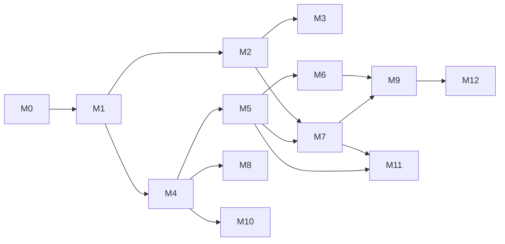

# Construction Management — milestones and tasks

Delivery plan for the rebuild described in [`../README.md`](../README.md). Same rules as the Whiteboard board: work **top to bottom inside a milestone**, do not start a ticket until every `Blocked by` ticket is `done`, update **Status** when you pick up or finish work, leave **Issue** blank until a tracker id exists.

Priority 1 is **M0 → M3** (project setup, SaaS login/signup and company onboarding, site-worker management, staff HRMS). Priority 2 is **M4 → M12**. Milestones after M3 are boards only; their tickets get "Done when" sections when the milestone before them is `done`.

## Legend

| Status        | Meaning                                                            |
| ------------- | ------------------------------------------------------------------ |
| `todo`        | Not started                                                        |
| `in_progress` | Someone is implementing it                                         |
| `blocked`     | Cannot proceed; note why in the ticket                             |
| `done`        | Merged and verified (tests + Storybook/UI where the ticket has UI) |

| Area   | Meaning                                                               |
| ------ | --------------------------------------------------------------------- |
| Docs   | ADR, CONTEXT.md, spec amendments                                      |
| Infra  | Repo wiring, CI, Docker, AWS                                          |
| Auth   | `@repo/auth` plugins and the identity bridge                          |
| Data   | Prisma schema files under `packages/db/construction/prisma/schema/*`  |
| Domain | `apps/construction-management/src/<context>/{domain,application}`     |
| HTTP   | Route Handlers + Zod models + OpenAPI under `/api/construction/<ctx>` |
| UI     | Screens in `apps/construction-management/app` + Storybook             |
| Kernel | `src/shared-kernel` (LocationRef, Money, SequenceRule, Approval…)     |

Ticket ids are `CM-<milestone><nn>`: `CM-105` is milestone 1, ticket 5.

---

## Milestones at a glance

| Milestone | Name                               | Spec                                                                                                                | Outcome the owner can see                                                                                       | Priority |
| --------- | ---------------------------------- | ------------------------------------------------------------------------------------------------------------------- | --------------------------------------------------------------------------------------------------------------- | -------- |
| **M0**    | Project setup                      | [03-target-architecture](../03-target-architecture.md)                                                              | App boots on :3002 against Postgres, CI green, `/api/docs` serves, first `construction_*` schema migrates       | 1        |
| **M1**    | SaaS onboarding & access           | [modules/01](../modules/01-organization-identity-access.md), [modules/12](../modules/12-settings-configuration.md)  | Sign up by mobile OTP or email, create a Company, invite team members, set the permission matrix, choose a plan | 1        |
| **M2**    | Site workforce (labour & vendor)   | [modules/08](../modules/08-labour-vendor-attendance.md), [modules/02](../modules/02-master-records.md)              | Register labour and vendor gangs, mark daily attendance with OT, see running balances, pay wages                | 1        |
| **M3**    | Staff HRMS                         | [modules/10](../modules/10-hrms.md)                                                                                 | Office staff check in within a geo-fence, apply for leave, HR runs shifts, holidays and monthly salary          | 1        |
| **M4**    | Projects & structure               | [modules/03](../modules/03-projects-structure-drawings-gallery.md)                                                  | Full project wizard, phases → wings → floors → units, drawings, gallery, testing reports                        | 2        |
| **M5**    | Procurement & inventory            | [modules/06](../modules/06-procurement-inventory.md)                                                                | PR → PO (GST) → GRN → stock → consume/transfer; central store                                                   | 2        |
| **M6**    | Daily site work                    | [modules/04](../modules/04-daily-site-work.md)                                                                      | Daily worksheet with material consumption, equipment usage, progress reports                                    | 2        |
| **M7**    | Finance                            | [modules/07](../modules/07-payments-accounting.md)                                                                  | Bank/cash ledgers, petty cash, party invoices & payments with TDS, ledger report                                | 2        |
| **M8**    | Tasks, issues, inspections         | [modules/05](../modules/05-tasks-issues-inspections.md)                                                             | Gantt tasks with earned value, snag list, inspection approvals                                                  | 2        |
| **M9**    | Dashboards, reports, notifications | [modules/11](../modules/11-reports-dashboards-backup.md), [modules/13](../modules/13-chat-notifications-support.md) | Company dashboard, reports on a queue, Central Reports, notifications and web push, backups (chat later)        | 2        |
| **M10**   | Sales CRM                          | [modules/09](../modules/09-sales-crm-inquiry-booking.md)                                                            | Inquiries, funnel, follow-ups, unit bookings                                                                    | 2        |
| **M11**   | India compliance                   | [04-gaps-and-roadmap §Phase 3](../04-gaps-and-roadmap.md)                                                           | BOQ/RA bills, GST engine, TDS ledger, muster rolls, RERA ledger, IS 456 registers                               | 2        |
| **M12**   | Differentiators                    | [04-gaps-and-roadmap §Phase 4](../04-gaps-and-roadmap.md)                                                           | WhatsApp bot, offline outbox, Tally sync, allottee & vendor portals                                             | 2        |

Dependency between milestones:

M2 needs a **minimal Project** (name, status, address) because labour and attendance are project-scoped; that slim aggregate ships in M2 (`CM-204`) and M4 grows it. M3 needs nothing from M2 except team members from M1.

---

## M0 — Project setup

Goal: the construction app is a real app in the monorepo with the same guarantees as Whiteboard — Postgres per context schema, `@repo/auth`, OpenAPI, tests on Postgres, CI, deploy path.

| ID     | Seq | Title                                                                                             | Status | Blocked by     | Area   | Issue |
| ------ | --: | ------------------------------------------------------------------------------------------------- | ------ | -------------- | ------ | ----- |
| CM-001 |   1 | ADR CM-0001: Construction Management app and `construction_*` schemas in the shared repo          | done   | —              | Docs   |       |
| CM-002 |   2 | CONTEXT.md for the construction app (vocabulary from `00-overview.md` glossary)                   | done   | CM-001         | Docs   |       |
| CM-003 |   3 | App wiring: `@repo/auth`, `@repo/ui`, `@repo/db`, Tailwind tokens, env, `docker compose`          | done   | CM-001         | Infra  |       |
| CM-004 |   4 | Prisma multi-file: `construction-organization.prisma` with a placeholder model + migration        | done   | CM-003         | Data   |       |
| CM-005 |   5 | HTTP skeleton: `/api/construction/*` error envelope, session guard, `/api/docs` OpenAPI           | done   | CM-003         | HTTP   |       |
| CM-006 |   6 | Test harness: domain unit tests + HTTP tests on `construction_test` Postgres                      | done   | CM-004, CM-005 | Infra  |       |
| CM-007 |   7 | CI: lint, typecheck, format, tests for the new app; Vercel/ECS preview per PR                     | done   | CM-006         | Infra  |       |
| CM-008 |   8 | Shared kernel v0: `Money`, `Quantity`, ids, `AuditEvent` writer, soft-delete helper               | done   | CM-004         | Kernel |       |
| CM-009 |   9 | App shell: public layout (auth pages) and authenticated shell with Projects/Workspace/Masters nav | done   | CM-003         | UI     |       |

### CM-001 — ADR CM-0001

**Done when:** `apps/construction-management/docs/adr/CM-0001-app-and-schemas.md` records: own app on :3002, own `construction_<context>` Postgres schemas in the app's own `construction` database (shared Prisma schema and migration history in `packages/db`), reuse of `@repo/auth`/`@repo/ui`/`packages/db`, Company = Workspace, no cross-import with Whiteboard contexts (ESLint rule). Lists the 12 contexts from `03-target-architecture.md §2`.

### CM-002 — CONTEXT.md

**Done when:** `apps/construction-management/CONTEXT.md` fixes the words: Company, Team Member, Designation, Department, Contractor, Supplier, Vendor, Labour, Other Party, Project, Phase/Wing/Floor/Unit, Amenity/Common Development, Worksheet, PR/PO/GRN/MT/MR/DN, Petty Cash, Transaction, Inquiry/Booking, Sequence ID, Back-dated entry. Includes the "say / do not say" table (e.g. say **Labour**, not worker; say **Team Member**, not user/employee in UI copy; say **Company**, not organization/tenant).

### CM-003 — App wiring

**Done when:** `bun run dev --filter=construction-management` serves :3002 with the `@repo/ui` theme; `.env.example` lists DB, auth, file storage (Vercel Blob; a local folder in development) and OTP provider keys; `docker compose` has the `construction` database alongside Whiteboard's; `bun run check-types` and `lint` pass.

### CM-004 — First Prisma schema file

**Done when:** `packages/db/prisma/schema/construction-organization.prisma` exists with `@@schema("construction_organization")`, a `ConstructionOrganizationCompanyProfile` model (workspaceId, gstin, pan, address, currency, isIndian, timezone) and a hand-written migration creating the schema. `base.prisma` lists the schema. Migration applies on a fresh database.

### CM-005 — HTTP skeleton

**Done when:** a `GET /api/construction/organization/company-profile` route returns the profile for the Active Workspace (404 if none), with Zod Request/Response models beside it, `{code,message,details?}` errors, 401/403 behaviour per root ADR-0013/0014, and the route appears on `/api/docs` with `ConstructionOrganization…` component names.

### CM-006 — Test harness

**Done when:** `bun run test --filter=construction-management` runs domain tests; `bun run test:http --filter=construction-management` runs the company-profile route against `construction_test` Postgres (migrated in `globalSetup`). One passing test of each kind.

### CM-007 — CI and previews

**Done when:** the GitHub workflow runs lint/typecheck/format/tests for the app on PRs touching it; a preview deployment URL is posted per PR (Vercel for now; ECS later per architecture §1 — record which in the ADR). The Vercel project itself (Root Directory `apps/construction-management`, build command `bash scripts/vercel-build.sh`) is created by the owner in the Vercel dashboard; its GitHub integration then posts the URL.

### CM-008 — Shared kernel v0

**Done when:** `src/shared-kernel` exports `Money` (integer paise + currency, add/sub/multiply, INR formatting `₹1,00,000.00`), `Quantity` (decimal + UoM id), uuid v7 ids, `recordAudit(event)` writing `construction_organization.audit_events`, and a `withTombstone` query helper. Unit tests for Money rounding and Indian grouping.

### CM-009 — App shell

**Done when:** `/sign-in`, `/sign-up` use the public layout (their forms arrive with CM-103); `/app/*` uses `AppShell` from `@repo/ui` with the three top-level areas (Projects, Workspace, Masters) and a company switcher placeholder; Storybook renders the shell with empty states.

---

## M1 — SaaS onboarding & access

Goal: a builder can sign up, create a Company, invite staff, decide what each one may do, and buy a plan — the "01 Organization, Identity & Access" spec minus devices and data-export, which move to M9.

> **Trial removed on 2026-10-09 at the owner's request; it will be designed later.** A new Company has no subscription: no plan, no limits and never expired until its Owner buys a plan. CM-104 and CM-116–118 below are amended.

> **Amended at the start of M2 (2026-10-08, [ADR CM-0009](../adr/CM-0009-email-sign-in-while-sms-is-off.md)):** SMS is off until the business can send DLT-registered texts. Sign-in is email and password, with a Forgot password flow. The mobile OTP routes (CM-102, CM-103) stay built behind `CONSTRUCTION_SMS=on`. Invitations (CM-109) go by email and share link only, and a Team Member with only a mobile is a record until an email is added.

| ID     | Seq | Title                                                                                                        | Status | Blocked by             | Area      | Issue |
| ------ | --: | ------------------------------------------------------------------------------------------------------------ | ------ | ---------------------- | --------- | ----- |
| CM-101 |   1 | ADR CM-0002: Company = Workspace; mobile-OTP login plugin in `@repo/auth`; roles `owner`/`member`            | done   | CM-001                 | Docs      |       |
| CM-102 |   2 | `@repo/auth`: mobile OTP sign-in/sign-up plugin (SMS provider adapter, rate limit, test bypass)              | done   | CM-101                 | Auth      |       |
| CM-103 |   3 | Sign-up / sign-in screens: mobile OTP first, email+password second, "Choose Organization" after login        | done   | CM-009, CM-102         | UI        |       |
| CM-104 |   4 | Company creation: name, mobile, email, country, currency, GSTIN/PAN (optional) → Workspace + profile         | done   | CM-005, CM-102         | Domain    |       |
| CM-105 |   5 | Company HTTP + Create Company screen (first-run wizard) + company switcher                                   | done   | CM-103, CM-104         | HTTP+UI   |       |
| CM-106 |   6 | Designation aggregate + seed set (38 names, 6 with templates) copied into each new Company                   | done   | CM-104                 | Domain    |       |
| CM-107 |   7 | Permission matrix: `menu` + `flag` enums, `MemberMenuPermission`, `can()` guard, designation templates       | done   | CM-106                 | Domain    |       |
| CM-108 |   8 | Team Member aggregate: Normal vs HRMS member, profile fields, project assignment stub, invite link           | done   | CM-107                 | Domain    |       |
| CM-109 |   9 | Invitation & join flow: invite by mobile/email, join request pending → accepted/rejected, multi-company      | done   | CM-102, CM-108         | Auth      |       |
| CM-110 |  10 | Team Members HTTP + OpenAPI (list, create, update, invite, resend, remove, permissions)                      | done   | CM-108, CM-109         | HTTP      |       |
| CM-111 |  11 | Team Member screens: list with status chips, add wizard (details → projects → permission matrix), edit       | done   | CM-105, CM-110         | UI        |       |
| CM-112 |  12 | Designations HTTP + screens (list, add, duplicate, edit template) and the shared Permission Matrix component | done   | CM-105, CM-106         | HTTP+UI   |       |
| CM-113 |  13 | Back-dated entry policy (global days, override designations, financial closing date) + guard                 | done   | CM-107                 | Kernel    |       |
| CM-114 |  14 | Sequence rules (`SequenceRule`, fiscal-year token, per-project scope, counters) + Settings screen            | done   | CM-107                 | Kernel+UI |       |
| CM-115 |  15 | Company profile & my-profile screens (logo, GSTIN/PAN masked, address, currency, timezone)                   | done   | CM-105                 | UI        |       |
| CM-116 |  16 | Plans & subscription: `Plan`, `Subscription`, usage counters (projects, members, HRMS seats, storage)        | done   | CM-104                 | Domain    |       |
| CM-117 |  17 | Razorpay checkout (order → webhook → activate), billing address, invoices list                               | done   | CM-116                 | HTTP+UI   |       |
| CM-118 |  18 | Plan enforcement: block create when usage exceeded; read-only on expiry; export always allowed               | done   | CM-116                 | Domain    |       |
| CM-119 |  19 | M1 polish: empty states, Storybook for every form, OTP/invite React Email templates                          | done   | CM-111, CM-115, CM-117 | UI        |       |

### CM-101 — ADR CM-0002

**Done when:** the ADR records: Company is a Better Auth Workspace; roles inside a Company are `owner` and `member` (fine-grained rights come from the matrix, not roles); login is mobile OTP (primary, as site staff know it) with email+password as secondary; a User may hold many memberships and switches the Active Workspace; HRMS-only members are ordinary members whose permissions start from the HRMS default set.

### CM-102 — Mobile OTP plugin

**Done when:** `@repo/auth` exposes `sendOtp(mobile)` / `verifyOtp(mobile, code)` as a Better Auth plugin with an SMS adapter interface (MSG91 or SNS implementation + console adapter for dev), 6-digit code, 5-minute expiry, 5 attempts, per-mobile rate limit, and a test bypass code in `whiteboard_test`/`construction_test`. HTTP tests for happy path, expiry, lockout.

### CM-103 — Auth screens

**Done when:** `/sign-up` and `/sign-in` accept +91 mobile → OTP → session; email+password as a secondary tab; after login a user with 0 companies lands on Create Company, with 1 goes straight in, with >1 sees "Choose Organization". Storybook play functions for each state.

### CM-104 — Company creation

**Done when:** `createCompany` command creates the Workspace via `@repo/auth`, makes the caller `owner`, writes `CompanyProfile`, copies the seed sets (designations now; departments/UoMs/categories arrive in M2/M4), and emits `CompanyCreated`. It creates no subscription: a Company has none until its Owner buys a plan (CM-117). Domain tests for invariants (name required, one owner).

### CM-105 — Company HTTP + screens

**Done when:** `POST /api/construction/organization/companies`, `GET …/companies/me`, `POST …/companies/{id}/switch`; the first-run wizard (Company name → contact → country/currency → done) and the company switcher in the shell header.

### CM-106 — Designations

**Done when:** `Designation` aggregate with `name`, `isSeed`, `permissionTemplate?`; seed JSON in `src/organization/infrastructure/seeds/designations.json` holding the 38 default names (the `modules/01` list expands to 38, not 37) and starter templates for Accountant, Admin, Project Manager, Site Engineer, Site Supervisor, Store Keeper (our own defaults per role; Admin has every cell); `duplicate` command.

### CM-107 — Permission matrix

**Done when:** ADR CM-0003; `Menu` enum lists every menu in `modules/01` by context (`organization.team_members`, `labour.attendance`, `hrms.leave_management` …); `Flag` enum `create read update delete approve reject print report view_all notification transfer financial export import`; `MemberMenuPermission(workspaceId, memberId, menu, flags bitmask)` (keyed by Team Member, so a Joining Pending member's matrix exists before they have a User; ADR CM-0003); `can(member, menu, flag, {projectId?})` used by every command/query; `applyTemplate(designation)`; `view_all=false` filters lists to own entries; `financial=false` nulls amounts in Response models. Unit tests for bitmask and both filters.

### CM-108 — Team Member aggregate

**Done when:** fields from `modules/01` (name, designation, mobile, email, address, Aadhaar, PAN, emergency contact, `memberType` normal|hrms, `isOwner`) — name and Designation required, plus a mobile **or** an email (site staff often have no email; ADR CM-0002), Aadhaar checked by its Verhoeff digit, PAN by format; the Owner gets their own record (Designation "Owner") when the Company is created; `assignToProjects(ids)` stored as ids (projects exist from CM-204); invite link token; Aadhaar/PAN stored encrypted and returned masked unless `reveal` is called (OTP-gated in M9).

### CM-109 — Invitation & join

**Done when:** invite by mobile or email → a Joining Pending Team Member is the invitation (ADR CM-0002; not a Better Auth invitation, which is email-only), sent by email and SMS with a `/join/<token>` link; invitee signs up/in with that mobile or email → sees the Join Request → accepts → `member` membership through `@repo/auth`; owner can resend/cancel; a user in several companies switches; `JoiningPending` chip until accepted. HTTP tests for invite → accept and for a rejected invite.

### CM-110 / CM-111 / CM-112 — Team Members & Designations HTTP and screens

**Done when:** routes on `/api/docs`; Team Member list (search, status chips, kebab: Share invite link, Edit, Delete), add wizard with the three steps from the legacy (`details → select projects → permission matrix` with column select-all, category expand, search); Designations list/add/duplicate with template editor using the same matrix component.

CM-112 detail: Designation routes are `GET/POST /designations`, `GET /designations/{id}`, `POST /designations/{id}/update|duplicate|delete`, each checked against the `organization.designations` menu. The list returns every live Designation by name with `total` and no cursor (a Company has a few dozen). Templates travel as `{ menuKey: Flag[] }`; unknown menus or flags are 400, unsupported cells are dropped. Deleting a Designation a live Team Member holds is 409 `DESIGNATION_IN_USE`. The matrix component is `components/permissions/permission-matrix.tsx`.

### CM-113 — Back-dated policy

**Done when:** `BackdatedPolicy` per workspace: `create.days`, `edit.days`, `overrideDesignationIds`, `financialClosingDate`, per-module overrides keyed by `module` + `entryDateField`; `assertCanCreate/Edit(module, entryDate, member)` in the kernel; Settings screen mirrors the legacy groups (Procurement, Site, Inventory, Accounts, Labour & Vendor, Sales, HRMS). Unit tests for global, override, closing date.

**Delivered:** `src/shared-kernel/backdated-policy.ts` (24-module catalogue, `assertCanCreate/Edit(policy, module, entryDate, { designationId, isOwner }, today)` with `today` a `YYYY-MM-DD` in the Company time zone) and `backdated-policy-reader.ts` (`loadBackdatedPolicy`, `loadBackdatedActor`) for commands in any context. The Owner passes day limits; the inclusive closing date blocks everyone (`modules/12` open questions 7 and 12). One row per Company in `construction_organization.backdated_entry_policies`, written on first save (no row = no limits). `GET …/settings/backdated-entry`, `POST …/settings/backdated-entry/update` (menu `organization.settings`), audited with before/after.

### CM-114 — Sequence rules

**Done when:** `SequenceRule(module, scope workspace|project, prefix, projectToken, startNumber, fiscalYearToken)`; `next(module, projectId, date)` → `PR/26-27/P1/00001` with row-locked counters per rule per fiscal year (April–March); "Manage Sequence IDs" screen with preview; unit test that 1 April rolls the FY.

**Delivered:** `src/shared-kernel/sequence/` (`SEQUENCE_MODULES` with snake_case keys and default prefixes PR, PO, GRN, MT, PC, MR, DN, IR, INV; `fiscalYearOf`; `formatSequenceNumber` — order prefix / FY / project token / number; `nextSequenceNumber(tx, { workspaceId, module, projectId, date, by })` for callers to run inside their own insert transaction). Counters are `construction_organization.sequence_counters (rule_id, fiscal_year)` incremented by an upsert that holds the row lock until the caller commits; fiscal_year is 0 for rules without the FY token (never restart). Partial unique indexes: one live default per module, one live rule per (module, project). HTTP under `organization.settings`: list, create, `{id}/update` (optimistic `expectedUpdatedAt`), `{id}/delete` (409 once a number was issued). The screen offers only "All projects (default)" until Projects exist (M2).

### CM-115 — Profiles

**Done when:** Company profile (name, logo to Vercel Blob, mobile, email, GSTIN with checksum validation, PAN format validation, address, currency, timezone) and My Profile (photo, contact, masked ids) screens; Storybook states.

Decided while building it:

- The Company's own GSTIN and PAN print on its documents, so they are shown in full to anyone with `organization.settings` read; only Team Members' personal Aadhaar and PAN are masked. Changing the profile or the logo needs `organization.settings` update; the logo image itself streams to every Team Member of the Company.
- The country is fixed when the Company is created (it decides GST, PAN, TDS and which plans are offered); the profile changes name (which also renames the Company in the switcher), mobile, email, GSTIN, PAN, address, currency and time zone. Saves carry the `updatedAt` the form loaded and are refused with `COMPANY_PROFILE_CHANGED` (409) when someone saved since.
- Files go through our routes (raw body with its `content-type`; no presigned browser upload) to private Vercel Blob storage (files on disk in development and tests) under `companies/<workspaceId>/...`, are checked by content (PNG, JPEG, WebP; logo ≤ 2 MB, photo ≤ 10 MB; `FILE_TOO_LARGE`, `FILE_TYPE_NOT_ALLOWED`), and are served only through routes that stream them to the Company's own Team Members. Every stored file is a row in `construction_organization.stored_files` (bytes, kind, deleted_at) for storage usage (CM-116).
- My Profile is the signed-in User's own Team Member record in the Active Company: photo, name, email, address, emergency contact, Aadhaar and PAN. The mobile is how they sign in and is read-only there. Email here is the Team Member's contact email; changing the User's sign-in email (with verification) is not part of M1. A member may always reveal their own Aadhaar and PAN; each reveal is audited, and the OTP step arrives with M9.

### CM-116 — Plans & subscription

**Done when:** `Plan` (includes: projects, team members, HRMS seats, storage GB; prices per duration), `AddOn` (per unit per month), `Subscription(workspaceId, planId, startsAt, endsAt, autoRenew, addOns[])`, `UsageSnapshot` computed from counts; `Your Subscription` read model (plan, expiry, usage bars).

Decisions (CM-116):

- The catalogue is versioned JSON, `src/organization/infrastructure/seeds/plans.json`; orders store `catalogueVersion`. Only **Basic** is known: 6 months ₹14,000, 12 months ₹21,000 (paise in the file), 10 Projects, 5 Team Members, **10 HRMS Team Members** (our number; open question), 20 GB. `rank` orders Plans for "same or higher".
- Prices are **before GST**; GST 18% is added and shown separately (CGST 9% + SGST 9% when the buyer's state is the seller's, IGST 18% otherwise).
- Add-ons per unit per month: Extra Team Member, Extra Project, 30 GB storage at ₹299 (minimum 1 each), HRMS Team Member ₹30 (minimum 5). At most 500 units per add-on per order.
- Status is derived from dates: `active`, or `expired` (now ≥ `endsAt`). A Company with no subscription row is `none`: the read model's `plan` is null and usage has no limits (`limit: null`). Days left count a part day as a day.
- Usage: Team Members are live Normal members including the Owner and Joining Pending invites; HRMS seats count HRMS members only; Projects count 0 until CM-204; storage sums `construction_organization.stored_files.bytes` once that table exists (0 before).
- `GET /api/construction/organization/subscription` is open to every Team Member of the Company; amounts and billing (`owner`) are null for a Member.

### CM-117 — Razorpay checkout

**Done when:** Choose plan → duration → add-ons → buyer details (billing address, GSTIN) → Razorpay order → webhook verifies signature → subscription activated/extended/upgraded ("new plan must be same or higher"); invoices list with PDF; test-mode keys in `.env.example`.

Decisions (CM-117):

- Order kinds: `new` (no running plan — none yet, or the last one ended; starts on payment; the Company's first paid order creates its subscription row), `extend` (same plan; months added to the current end; running add-ons renewed for the same months), `upgrade` (rank ≥ current; starts on payment; add-ons chosen again), `add_ons` (running plan only; charged per unit per day as 1/30 of the monthly price for the days left). Without a running plan only `new` can be bought; a running plan cannot buy `new`.
- **Last Plan Discount** = the pre-GST value paid for the running period (plan and add-ons) × days left ÷ days in the period, capped at the Sub Total. Coupons are not built.
- Orders are immutable rows (`created → paid | failed`) with the full price snapshot, buyer details (name, address, GST state, optional GSTIN that must match the state) and the seller block. A `failed` order can still be paid by a later attempt on the same Razorpay order.
- Payment is settled by the webhook (`payment.captured` / `order.paid`, `X-Razorpay-Signature` HMAC-SHA256 of the raw body) **and** by `checkout/verify` (HMAC of `order_id|payment_id` with the key secret), whichever arrives first; both lock the order row, so replays never extend twice.
- A paid order is the tax invoice, numbered `CM/<FY>/<00001>` per Indian fiscal year (16 characters at most). Seller name, address, GSTIN, state (default 27 Maharashtra) and SAC (default 997331) come from `CONSTRUCTION_SELLER_*`. The buyer's billing address is kept on the order; a reusable list of Company GST registrations (rebuild recommendation 8) waits for Procurement.
- Without `RAZORPAY_KEY_ID`/`RAZORPAY_KEY_SECRET` the checkout shows "Payments are not configured" and `POST …/checkout` returns 503 `PAYMENTS_NOT_CONFIGURED`.

### CM-118 — Enforcement

**Done when:** creating a project/member/HRMS member beyond the plan returns `PLAN_LIMIT_EXCEEDED` (402) with `{ grant, limit, used }` in `details`; expired plan → all commands except export return `PLAN_EXPIRED` (402); owner-only checkout; banner in the shell. HTTP tests for each.

Decisions (CM-118):

- The `PlanGate` port lives in the shared kernel (`src/shared-kernel/plan.ts`) so every context's create commands can ask it; the organization context implements it (`SubscriptionPlanGate`, composed by `createPlanGate()`).
- Expiry is checked centrally in `requireAccess` for the write flags `create update delete approve reject transfer import`; `read print report view_all notification financial export` stay open. Owner-only command routes that use `requireOwnerSession` call `requirePlanActive(session)`. The subscription, checkout and webhook routes, sign-out and Company switching are never blocked.
- A Company with no subscription row (no plan bought yet) is neither limited nor expired.

---

## M2 — Site workforce (labour & vendor)

Goal: the daily reality of a site — who came, for how long, what they are owed — for both the company's own labour and vendor gangs, per project. Spec: `modules/08` plus the Labour/Vendor/Category/Supervisor masters from `modules/02`. Payments stay minimal (record a wage payment against the balance; full ledgers arrive in M7).

| ID     | Seq | Title                                                                                                                                                                        | Status | Blocked by     | Area           | Issue |
| ------ | --: | ---------------------------------------------------------------------------------------------------------------------------------------------------------------------------- | ------ | -------------- | -------------- | ----- |
| CM-201 |   1 | ADR CM-0004 (ledger-first balances): labour and vendor balances are derived from immutable entries                                                                           | done   | CM-001         | Docs           |       |
| CM-202 |   2 | Prisma: `construction-labour.prisma` and `construction-masters.prisma` (labour subset) + migration                                                                           | done   | CM-004, CM-201 | Data           |       |
| CM-203 |   3 | Masters: Labour Category (seed 9), Supervisor, Department (seed 54) aggregates + HTTP + screens                                                                              | done   | CM-107, CM-202 | Domain+HTTP+UI |       |
| CM-204 |   4 | Minimal Project aggregate (name, status, address, start/end) + HTTP + list/create screen                                                                                     | done   | CM-107, CM-202 | Domain+HTTP+UI |       |
| CM-205 |   5 | Labour aggregate: wage type daily/monthly, weekly holidays, wage, OT/hr, opening balance → ledger, statutory ids, photo/docs, current project                                | done   | CM-203, CM-204 | Domain         |       |
| CM-206 |   6 | Labour transfer between projects with history; active/inactive; Excel import/sample export                                                                                   | done   | CM-205         | Domain+HTTP    |       |
| CM-207 |   7 | Labour HTTP + OpenAPI; Labour screens (list by project, add/edit, transfer, import)                                                                                          | done   | CM-205, CM-206 | HTTP+UI        |       |
| CM-208 |   8 | Vendor aggregate: shifts with per-category rate (rate/day, OT/hr), joining date, docs, project assignment                                                                    | done   | CM-203, CM-204 | Domain         |       |
| CM-209 |   9 | Vendor HTTP + screens (list, add with shift/category rate card, edit)                                                                                                        | done   | CM-208         | HTTP+UI        |       |
| CM-210 |  10 | Labour attendance: per date per project; Present/Half/Absent/On Leave/Holiday/Paid Leave; shift; supervisor; OT lines (category, wages/hr, hours ≤ 24); multi-select marking | done   | CM-205, CM-113 | Domain         |       |
| CM-211 |  11 | Labour attendance HTTP + screens (mark day for many, recorded list, edit, filters)                                                                                           | done   | CM-210         | HTTP+UI        |       |
| CM-212 |  12 | Vendor attendance: per date per vendor per category/shift: full-day count, half-day count, OT hours → pay from rate card                                                     | done   | CM-208, CM-113 | Domain         |       |
| CM-213 |  13 | Vendor attendance HTTP + screens (grid by category, OT attendance, month view)                                                                                               | done   | CM-212         | HTTP+UI        |       |
| CM-214 |  14 | Balances: `LabourLedger`/`VendorLedger` entries (opening, earned per day, OT, advance, payment); To Pay / Advance / Previous / Final for monthly, weekly, custom periods     | done   | CM-210, CM-212 | Domain         |       |
| CM-215 |  15 | Wage payment command (date, mode Cash/Bank, reference, amount, paid by, remarks, document) posting to the ledger; "Mark Paid Leave"                                          | done   | CM-214         | Domain+HTTP    |       |
| CM-216 |  16 | Payment screens: labour & vendor payment lists, pay dialog, balance view                                                                                                     | done   | CM-215         | UI             |       |
| CM-217 |  17 | Reports: All Labour Attendance, All Labour Payment, Month-wise Labour, Vendor Attendance (Excel/PDF jobs)                                                                    | done   | CM-214         | HTTP+UI        |       |
| CM-218 |  18 | Muster roll export (Form XVI/XVII combined register) per contractor/project per month                                                                                        | done   | CM-217         | HTTP           |       |
| CM-219 |  19 | M2 polish: dashboard widgets (labours present, labour/vendor payment status), empty states, Storybook                                                                        | done   | CM-216, CM-217 | UI             |       |
| CM-220 |  20 | Labour attendance check-in / check-out, break, working hours per Labour (default 8), overtime from times (ADR CM-0011)                                                       | done   | CM-210, CM-211 | Domain+HTTP+UI |       |

### CM-201 — ADR CM-0004

**Done when:** the ADR records: every balance (labour, vendor, later petty cash/bank/stock) is the sum of immutable ledger entries; "Opening Balance" is an entry; edits create reversing entries; reports read closing balances from entries.

### CM-203 — Masters subset

**Done when:** Labour Categories (seed: Carpenter, Electrician, Helper, Labour, Mason, Plumber, Skilled, Unskilled, Welder), Supervisors (name), Departments (seed list from `modules/02`) with list/add/edit/disable screens under Masters; seeds copied per company at creation (hook into CM-104).

**Delivered:** the `masters` context (`src/masters/`): `LookupEntry` (Labour Category and Department share one aggregate and one set of handlers, each with its own table) and `Supervisor` (name, optional E.164 mobile, optional `teamMemberId` checked against live Team Members through a `TeamMemberDirectory` port read of `construction_organization.team_members`). Names are trimmed, required, at most 100 characters and unique per Company among live rows, any case (`<ENTITY>_NAME_IN_USE`). Seed rows can be disabled and enabled, never renamed or deleted (`SEED_IS_READ_ONLY`). Every write compares-and-sets `updatedAt` (update carries `expectedUpdatedAt` → `<ENTITY>_CHANGED`; disable, enable and delete use the `updatedAt` they loaded) and writes its audit event in the same transaction; delete is a tombstone with `deletedBy`, refused with `LABOUR_CATEGORY_IN_USE` / `SUPERVISOR_IN_USE` while live labourers, vendor rate cards or attendance point at the row (a `MasterUsage` port over the `construction_labour` tables). HTTP under `/api/construction/masters/{labour-categories,departments,supervisors}`: `GET` list (all live rows by name with `disabled`, plus `total`, no cursor; `?status=enabled` for pickers), `POST` create, `GET {id}`, `POST {id}/update|disable|enable|delete`; menus `masters.labour_categories`, `masters.departments`, and `masters.labours` for Supervisors; OpenAPI tag "Construction · Masters". Seeds: `CompanyCreated` reaches `SeedCompanyMastersListener` through `src/composition/company-created-listeners.ts`; the copy skips names the Company already has, so it is idempotent (Companies created before M2 got theirs from the migration). Screens: Masters → Labour & Vendors → Labour Categories, Supervisors; Masters → Work → Departments (one list pattern with an Add/Rename dialog, a "Default" badge for seed rows like Designations, muted disabled rows, and a confirm before delete).

### CM-204 — Minimal Project

**Done when:** `Project(name*, status Ongoing|Completed|NotStarted|OnHold, address, startDate, endDate)` with plan-limit check (CM-118), member assignment check in `can()`, Projects home with status filter chips and cards; everything else about projects waits for M4.

**Delivered:** the `projects` context (`src/projects/`): `Project` (name ≤ 120 tidied, status default Ongoing, address ≤ 500, start/end calendar dates, end ≥ start → `PROJECT_DATES_INVALID`), live names unique per Company (`PROJECT_NAME_IN_USE`), edits with `expectedUpdatedAt` (409 `PROJECT_CHANGED`), tombstone deletes refused while labours, assigned vendors, attendance or wage payments point at the Project (`PROJECT_IN_USE`), every write audited in its transaction. Create asks the kernel `PlanGate` for `project` (402 `PLAN_LIMIT_EXCEEDED`); usage counts live rows of `construction_projects.projects`. HTTP under `/api/construction/projects/projects` (menu `projects.project`): list with `?status=` and counts per status, create, `{id}`, `{id}/update`, `{id}/delete`, and `options` (id, name, status) for pickers, open to every Team Member. The Owner sees every Project; a Member only the ones assigned to them, and any other is 404. A Member who adds a Project is not assigned to it. Screens: Projects home (status chips with counts, cards, empty state), New Project page, project shell (header with Edit; Overview, Attendance, Payments, Reports tabs, the last three placeholders for CM-211/216/217), Edit with Delete. Team Member project ids and project-scoped Sequence ID rules must be live Projects of the Company (400 `PROJECT_NOT_FOUND`); the Select Projects step is a checklist and Sequence IDs offers real Projects.

### CM-205 / CM-206 / CM-207 — Labour

**Done when:** all fields from `modules/08` Labour table; wage type drives which wage field is required; opening balance becomes the first ledger entry; Aadhaar/UAN/ESIC validated by format; `currentProjectId` required; domain tests for wage/OT invariants.

**Delivered:** `src/labour/domain/labour.ts` (`Labour` aggregate and `checkLabourDetails`: name ≤ 100, optional Labour Id ≤ 30 and father's name, joining date, wage type with the wage of that type > 0 (`WAGE_REQUIRED`) and the other wage cleared, OT wage ≥ 0, weekly holidays 0–6 unique, UAN 12 digits, ESIC 10 or 17, Aadhaar by Verhoeff (stored encrypted, returned masked), E.164 contact, gender). `PrismaLabourRepository` writes the labourer, the first history row (`from_project_id` null, dated the joining date), the opening ledger entry (`kind=opening`, `source_type=labour`, project null) and the audit event in one transaction; an edit with a changed opening balance or joining date reverses the live opening entries and posts the new one (a new joining date also moves the first history row, and may not pass the first transfer or attendance day); `expectedUpdatedAt` → 409 `LABOUR_CHANGED`; Labour Id unique among live labourers, case-insensitive (409 `LABOUR_CODE_TAKEN`). Transfer (one or many, all or none): destination ≠ current (`TRANSFER_SAME_PROJECT`), date on or after the last transfer (`TRANSFER_BEFORE_LAST_TRANSFER`) and after the latest attendance day (`TRANSFER_BEFORE_ATTENDANCE`; a transfer dated on an attendance day is refused, since that day belongs to the old Project); `projectOn`/`projectsOn` in `src/labour/infrastructure/labour-project-on.ts` give the Project on a date for CM-210. Delete = tombstone + opening reversal, refused 409 `LABOUR_HAS_RECORDS` once attendance or wage payments exist; Inactive leaves the pickers. Photos and documents are a generic `PartyFiles` module (`src/labour/application/party-files.ts`, owner `labour` or `vendor`; PDF/PNG/JPEG/WebP ≤ 10 MB sniffed by content, `stored_files` kinds `labour_photo|labour_document|vendor_photo|vendor_document`). HTTP under `/api/construction/labour/labours` (Menu `masters.labours`; Without Financial wages, OT wage, opening balance and balance are null and an edit that omits them keeps them): list (`projectId`, `active`, `q`, `supervisorId`, `categoryId`, cursors + total), create, `{id}`, `{id}/update|activate|deactivate|delete`, `{id}/transfers`, `transfer` (`labour.labour` transfer on the destination and every source Project), `options?projectId=&date=` (`labour.attendance` read on the Project; rates need `labour.labour` Financial), `import-template`, `import?dryRun=` (raw .xlsx body, ≤ 1000 rows, names matched case-insensitively, all or nothing; 400 `IMPORT_HAS_ERRORS` with the preview), `export`, photo and documents. `masters.labours` has no import/export flags, so import needs `create` and template/export need `read`. Screens: Masters → Labours (filters, multi-select transfer, transfer history sheet, import dialog with row preview, export), Add/Edit Labour with Photo & documents on Edit.

### CM-208 / CM-209 — Vendors

**Delivered:** `src/labour/domain/vendor.ts` (`Vendor` aggregate and `buildRateCard`: name ≤ 120, joining date, E.164 contact, Projects, rate card of shifts with optional `HH:MM` times, unique shift names, ≥ 1 category rate per shift, `DUPLICATE_SHIFT_CATEGORY`, paise ≥ 0; a `null` amount keeps the current rate; `rateFor(shiftId, categoryId)` refuses `VENDOR_INACTIVE`, `VENDOR_NO_RATE_CARD`, `CATEGORY_NOT_ON_SHIFT` for CM-212). A vendor may be saved without shifts; the list shows "No rate card". `PrismaVendorStore` writes the vendor, Projects, rate card, opening ledger entry (`kind=opening`, `source_type=vendor`, dated the joining date) and audit event in one transaction; an edit replaces rates in place, soft-deletes removed shifts, and reverses + reposts the opening entry when the amount or joining date changes; `expectedUpdatedAt` → 409 `VENDOR_CHANGED`; delete is a tombstone that reverses the opening entry, refused 409 `VENDOR_HAS_RECORDS` once vendor attendance or wage payments exist. HTTP under `/api/construction/labour/vendors` (Menu `masters.vendors`): list (`q`, `projectId`, `active`, cursors + total), create, get, `{id}/update|activate|deactivate|delete`, photo and documents (party files, owner `vendor`), and `options?projectId=` (active assigned vendors with live shifts; needs `labour.attendance` read on the Project; rates need `labour.vendor` Financial). Without Financial, rates, opening balance and balance are null in responses; amounts may still be entered (the same rule as labourers), and a `null` amount keeps the stored one. New categories must be live and enabled (`LABOUR_CATEGORY_NOT_FOUND`, `LABOUR_CATEGORY_DISABLED`); Projects must exist (`PROJECT_NOT_FOUND`). Screens: Masters → Vendors (list, Add, Edit with the rate card editor); `components/money/money-input.tsx` (rupees on screen, paise in the API).

### CM-210 — Labour attendance

**Done when:** one row per labour per date per project (unique); statuses as listed; OT lines validate hours ≤ 24 and category ∈ labour categories; back-dated guard applies with `module = labour_attendance`; marking for many labours in one command; `AttendanceMarked` event carries the day's earned amount (wage per day or monthly/working-days, half = 50%, OT = hours × wages/hr) for the ledger.

### CM-210 / CM-211 — Labour attendance delivered

**Delivered:** `LabourAttendanceHandlers` (`src/labour/application/labour-attendance-handlers.ts`, store port `LabourAttendanceStore`, Prisma `src/labour/infrastructure/labour-attendance-store.ts`) marks many labourers' day on a Project in one transaction: `assertDistinctLabourers`; every labourer live (404 `LABOUR_NOT_FOUND`), active (`LABOUR_INACTIVE`) and on that Project on that date by transfer history (`LABOUR_NOT_ON_PROJECT`, `details.projectId` = where they were); no future dates (`ATTENDANCE_DATE_IN_FUTURE`); overtime categories and explicit Supervisors live (`LABOUR_CATEGORY_NOT_FOUND`, `SUPERVISOR_NOT_FOUND`); the Supervisor snapshot defaults to the labourer's own. A labourer already marked that day needs their row's `updatedAt` in `expected` (missing or stale → 409 `ATTENDANCE_CHANGED`); new rows need Attendance create and the back-dated create limit, re-marks need Attendance update and the edit limit (`module = labour_attendance`); every per-row error carries `details.labourId`. Each row is priced with `priceDay` from the labourer's current wages (also on a re-mark), its overtime lines replaced, its ledger entries reversed (`reverseSource("labour_attendance", id)`) and `dayLedgerEntries` posted, with an audit event, all in one transaction; the ledger entries in the same transaction are the `AttendanceMarked` feed (no separate event bus). `clearDay` tombstones rows and reverses their entries (all or none, `expected` per row); `setPaidLeave` ("Mark Paid Leave") applies `withPaidLeave` to the stored snapshot and reposts. Queries: the marking sheet (active labourers on the Project that day with category, Supervisor, weekly holidays, wages, the day's row, `suggestedStatus` = Holiday on a weekly holiday else yesterday's status, `yesterday` for "Copy yesterday", read-only rows for labourers marked here who since left or went inactive, live categories for the OT picker, Supervisors for the filter, day totals), the recorded list (dates, labourer, Supervisor snapshot, status incl. `paid_leave`; newest date first; bidirectional cursors on (date, id) + total) and the month grid (labourer × day codes P/H/A/L/PL/HO + OT hours; totals present, half, absent, leave, paid leave, holidays, OT hours, earned, overtime, total; per-day headcount; roster labourers with no marks listed too). HTTP under `/api/construction/labour/attendance/labour` (menu `labour.attendance` on the Project): `GET sheet?projectId=&date=`, `POST mark` (200 `{ items }`), `POST clear` (204), `POST {id}/paid-leave`, `GET ?projectId=&from=&to=&labourId=&supervisorId=&status=&limit=&after|before=`, `GET month?projectId=&month=YYYY-MM`; wages, earned, OT rates and amounts are null without `labour.labour` Financial. Screens: Project → Attendance → Labour with Mark / Recorded / Month tabs (`components/attendance/labour/`): date picker, Supervisor filter, search, a row per labourer with P / ½ / A / Leave / Holiday buttons, Paid Leave switch on Leave, shift select (General, Shift 1–3), expandable OT lines (category, hours, rate defaulting to the OT wage), multi-select with "Mark selected Present / Absent / Holiday" and "Clear day", "Mark all present" (skips weekly holidays) and "Copy yesterday", weekly holidays pre-filled Holiday, dirty-row marker, Save sends only dirty rows with their loaded `updatedAt`, server errors shown on the row by `details.labourId`; Recorded has filters, cursors and "Mark Paid Leave" on leave days; phone-first stacked rows, a table row layout on desktop.

### CM-212 — Vendor attendance

**Done when:** one row per vendor per date per project with lines per (shift, category): full-day count, half-day count, OT hours; pay = full × rate + half × rate/2 + OT × OT rate from the vendor's rate card as of that date; event feeds the vendor ledger.

### CM-212 / CM-213 — Vendor attendance delivered

**Delivered:** `VendorAttendanceHandlers` (`src/labour/application/vendor-attendance-handlers.ts`) prices a day with the domain's `priceVendorDay` from the vendor's live rate card. It refuses a future date (`ATTENDANCE_DATE_IN_FUTURE`), a missing Project or vendor (404), a vendor not assigned to the Project (`VENDOR_NOT_ON_PROJECT`, **400**, the same as `CATEGORY_NOT_ON_SHIFT`), an inactive vendor (`VENDOR_INACTIVE`) and a vendor without a rate card (`VENDOR_NO_RATE_CARD`). Line errors carry `details.lineIndex`, `shiftId` and `labourCategoryId`. A new day passes the back-dated create limit. A recorded day changes only with `expectedUpdatedAt` (a missing or stale one is 409 `VENDOR_ATTENDANCE_CHANGED`), Attendance update and the edit limit. **An edit re-prices every line from the current rate card.** Clearing a day uses the edit limit. `PrismaVendorAttendanceStore` writes the row, its lines, `reverseSource` + the new `earned` entry and the audit event (`vendor_attendance.recorded|updated|cleared`) in one transaction. The partial unique index turns a racing create into a 409. A cleared row is a tombstone with its entry reversed, so the day can be recorded again. HTTP under `/api/construction/labour/attendance/vendors` (Menu `labour.attendance` on the Project; amounts need `labour.vendor` Financial and are null without it):

- `GET day?projectId&date`: the grid of active assigned vendors with their rate cards and recorded lines, plus read-only rows for vendors recorded that day who have since left the Project.
- `POST record`: 201 for a new day (create), 200 for an edit (update).
- `POST {id}/clear`: 204; needs delete.
- `GET ?projectId&from&to&vendorId&categoryId&page&pageSize`: a simple page plus total, newest first.
- `GET month?projectId&month=YYYY-MM`: the vendor × day matrix with totals per vendor, Labour Category and day.
- `GET overtime?projectId&from&to`: at most 366 days.

Screens: the project's Attendance tab is a layout with Labour / Vendor sub-tabs. `/attendance` redirects to `labour`, which is a placeholder until CM-211. `/attendance/vendors` has three views:

- **Day:** date picker defaulting to today, previous/next. Each vendor gets a card with, per shift, a row per category: Full day / Half day / OT hours with numeric keypads, a pay preview per line and a day total using the server's formula, Save, Clear day, and Copy yesterday.
- **Month:** the matrix and category totals.
- **Overtime:** overtime lines for a date range.

Empty states: no vendors on the Project (links to Masters → Vendors), and a vendor without a rate card (links to the vendor).

### CM-214 — Balances

**Done when:** ledgers are append-only; period summaries (monthly/weekly/custom) return opening, earned, OT, advances, payments, closing; "Previous Balance", "To Pay", "Advance", "Final Amount" match the legacy labour payment screen; unit tests with a 31-day month including half days and OT.

**Delivered:** `src/labour/application/balance-handlers.ts` (`BalanceHandlers.balances` and `.statement`, pure `statementOf` / `totalOf`) over `PrismaBalanceStore` (`src/labour/infrastructure/balance-store.ts`); the period figures are the domain `summarize()` (the 31-day month, half-day and OT unit tests are in `domain/ledger.test.ts` and `wages.test.ts`). **A balance belongs to the party, not the Project** (`modules/08`): every figure (Previous Balance, To Pay, Advance, Paid, Final Amount) sums all of the party's entries across Projects; the Project only decides who is listed — labourers whose current Project it is and vendors assigned to it (joined by the period's end), plus any party with an entry in this Project during the period (`onProject` false, badge "Other Project"). HTTP `GET /api/construction/labour/balances?projectId=&partyType=labour|vendor&kind=monthly|weekly|custom&anchor=&to=` (anchor defaults to the Company's today; rows by name plus a totals row) and `GET …/balances/statement?projectId=&partyType=&partyId=&from=&to=` (≤ 3660 days; opening before `from`, every entry with its Project, source, running balance, `isReversal`/`isReversed`, and the payment behind it; the party must be on the Project or have entries in it, else 404). Menus: labour → `labour.labour`, vendor → `labour.vendor`, read on the Project; without Financial every amount is null (names and counts stay).

### CM-215 — Wage payments

**Delivered:** `WagePaymentHandlers` (`src/labour/application/wage-payment-handlers.ts`) over `PrismaWagePaymentStore` (`src/labour/infrastructure/wage-payment-store.ts`, factory `wage-payment-factory.ts`). `record`: the domain `wagePayment()` checks (amount > 0, reference ≤ 100, remarks ≤ 500), the Project live (404 `PROJECT_NOT_FOUND`), the party live in the Company (404 `LABOUR_NOT_FOUND` / `VENDOR_NOT_FOUND`; inactive parties can still be paid, to settle someone who left), a vendor assigned to the Project (400 `VENDOR_NOT_ON_PROJECT`; a labourer may be paid on any live Project), "Paid by" a live Team Member (400 `TEAM_MEMBER_NOT_FOUND`), the date not after today (400 `PAYMENT_DATE_IN_FUTURE`), then the back-dated guard; the row, its one negative ledger entry (`paymentLedgerEntries`) and the audit event in one transaction. **No edit:** `cancel` (with `expectedUpdatedAt`, 409 `PAYMENT_CHANGED`; already cancelled = 404) tombstones the row and `reverseSource("wage_payment", id)`; correct a payment by cancelling and recording it again. Back-dated guard: the catalogue has no `labour_payment` / `vendor_payment` module and no per-group setting, so payments use the Company's default create/edit limits (what Labour & Vendor modules use in global mode) and the Financial Closing Date, with the kernel's codes (`BACKDATED_CREATE_BLOCKED`, `BACKDATED_EDIT_BLOCKED` on cancel, `FINANCIAL_PERIOD_CLOSED`). Bank without a reference is accepted by the API and required by the screen. One receipt per payment (`document_key`; PDF/PNG/JPEG/WebP ≤ 10 MB sniffed by content; `stored_files` kind `wage_payment_receipt`; compare-and-set, 409 `RECEIPT_CHANGED`; a replaced or removed file is marked deleted). HTTP under `/api/construction/labour/payments` (menu by party type, on the payment's Project): `GET` list (`projectId`, `partyType?` — without it the types the caller may read —, `partyId`, `kind`, `from`, `to`, cursors, `total`, `totalAmount`), `POST` record (create), `GET {id}`, `POST {id}/cancel` (delete), `GET|POST {id}/receipt` (read / create), `POST {id}/receipt/remove` (delete), `GET payers?projectId=&partyType=` (active Team Members and the caller's own, the "Paid by" default; create). Amounts are null without Financial. OpenAPI: `payments/payment-openapi.ts` merged in `openapi-document.ts`. "Mark Paid Leave" is CM-210/211's (attendance owns it).

### CM-216 — Payment screens

**Delivered:** Project → Payments (`app/app/projects/[id]/payments/page.tsx`, `components/payments/`): tabs Labour, Vendor and Payments. Labour and Vendor share a period switcher (Monthly with previous/next month, Weekly Monday–Sunday with previous/next week, Custom with a date range) and a balances table — Previous Balance, To Pay, Advance, Paid, Final Amount and a totals row; cards on phones. Pay opens the pay dialog (react-hook-form + zod: date default today, Payment/Advance, Cash/Bank with a required reference for Bank, amount defaulting to the Final Amount when > 0, Paid by defaulting to the signed-in Team Member, remarks, optional receipt uploaded after the payment is recorded; rupees on screen, paise to the API). A row opens the statement sheet (entries with Project and running balance, cancelled and reversal entries muted, receipt link, Cancel payment with a confirm). The Payments tab lists recorded payments with type, kind and date filters, cursors, the total, receipts and Cancel. Reads are `queryOptions` + `useSuspenseQuery` in `src/queries/{balances,payments}.ts`; recording or cancelling invalidates payments and balances. Storybook play stories: period switch, pay from a row, pay dialog defaults/validation/paise/server refusal, statement with cancel, and the empty states.

### CM-217 / CM-218 — Reports and muster roll

**Done when:** report requests enqueue a job (M0's harness runs it inline until M9 adds the queue), produce Excel + PDF to Vercel Blob, and return a download link; the combined muster-roll/wage register has the columns required by the CLRA Ease-of-Compliance combined register (name, father's name, category, days worked, wage rate, OT, gross, deductions, net, signature column) — see research doc §2 Labour.

**Delivered:** a new `reporting` context (`src/reporting/`, Postgres schema `construction_reporting`, one table `report_jobs`: kind, Project (null = central), params, status `queued|running|done|failed`, `includes_money`, Excel and PDF storage keys, download name, error, requester, created/started/finished). **Job harness:** `ReportHandlers.request` validates the period (≤ 366 days, real month; 400 `REPORT_PERIOD_INVALID|REPORT_PERIOD_TOO_LONG`) and the Project (404), inserts the job `queued` and hands it to a `ReportRunner` port. M2's `inlineReportRunner` calls the `ReportExecutor` in the same request: running → reads (a read model over the labour, masters, projects and organization tables; no labour code imported) → pure builders lay out a `ReportDocument` (header, notes, tables with totals rows) → `exceljs` and `pdf-lib` render it → both files go to private storage under `companies/<id>/reports/` and are recorded as `stored_files` kind `report` in the same transaction that marks the job done. A failure marks it `failed` with a screen-safe message (a domain refusal keeps its words; anything else gets a generic message, logged with its stack) and deletes any file already written. **M9 swaps the runner for one that sends the job id to SQS; the worker calls the same executor**, and the screen already polls while a job is queued or running. Reports, each an .xlsx (one sheet per table: Company, report, Project, address, period, generated at in the Company time zone, notes, frozen header row, totals) and a landscape PDF (A4; A3 for the muster roll; header on every page, repeated table header, totals, Page x of y; standard fonts, so `₹` prints as `Rs.`): **All Labour Attendance** (summary per Labour: present, half day, absent, leave, paid leave, holiday, OT hours; plus day by day), **All Labour Payment** (Previous Balance, Earned, Overtime, To Pay, Advance, Paid, Final Amount by ADR CM-0004's mapping, opening entries up to the period's end in Previous Balance, reversals netting by kind; Labours on the Project now or with ledger entries for it in the period; figures are the Labour's whole ledger because a balance moves with them), **Month-wise Labour** (Labour × day P/½/A/L/PL/H, counts, OT hours; Earned / OT amount / Total only with Financial), **Vendor Attendance** (per day, shift and Labour Category: full, half, OT hours; rates and pay only with Vendor Financial; optional vendor and category filters; `projectId: null` is the Central Vendor Attendance Report over the Projects the requester is on, or every Project for the Owner, openable only by its requester and the Owner), and the **muster roll and wage register** (CM-218: Sl. No., name, father's name, category, sex, a column per day with OT as `P+2`, days worked = present + ½ × half days, paid days by the M2 wage rules, wage type and rate from the last marked day's snapshot, basic earned, OT hours and amount, gross, Advance, Deductions, net payable = gross − advance − deductions, paid in month, blank signature / thumb impression column). The register covers the Company's own Labours on the Project (marked in the month, or on it and joined by its end); vendor headcount is not named, so vendors are not on it. M2 has no deductions engine: Deductions is 0 and advances paid in the month (ledger entries for the Project) are shown and taken off Net payable; both are stated in the header notes. HTTP under `/api/construction/reporting/reports` (labour kinds: `labour.labour` Report on the Project; vendor: `labour.vendor` Report): `POST` (discriminated by `kind`; 201 with the job, usually `done` with download links; the payment report and the muster roll are refused 403 without Financial; other kinds print amounts only with it and record that on the job), `GET ?projectId=` (newest 50 of the kinds the member may report on; without `projectId`, their own central reports), `GET {id}` (another Company's job is 404), `GET {id}/download?format=xlsx|pdf` (re-checks Report on the menu and Project, and Financial when the file carries amounts; 409 `REPORT_NOT_READY`; streams with the file's content type). Screen: the Project's Reports tab has a card per report (what it contains, what it needs, From/To or Month, Generate with progress, then Excel / PDF downloads or the failure message) and Recent reports with Ready / Failed / Generating chips. Not built: one-running-job-per-user guard and file retention (not needed while jobs run inline), the logo in the header, vendor and category pickers on the vendor card (the API takes them), and a Central Reports screen (the API supports the central vendor report).

### CM-219 — M2 polish

**Delivered:** a Project's Overview opens with **Labour today**: Labours present of those on the Project (with unmarked, half day, absent), vendor heads and how many vendors were recorded, what is owed to Labours and to vendors (party-wide ledger balances, advances shown separately, null without Financial), and a 14-day bar chart of Labours present with a screen-reader table (`GET /api/construction/labour/summary`, menu `labour.attendance` read; `components/projects/project-labour-tiles.tsx`). Every M2 list and screen has an empty state and Storybook play stories (183 stories in the app). UI copy says Labour / Labours, never labourer (CONTEXT.md). Money inputs select their amount on focus. A re-mark by a member without Financial keeps a custom overtime rate.

### CM-220 — Check-in, check-out and working hours

**Delivered:** [ADR CM-0011](../adr/CM-0011-attendance-check-in-out-and-working-hours.md); migration `construction_labour_attendance_times` (`labours.working_hours_per_day` decimal(4,2) default 8; `labour_attendance.check_in`, `check_out` char(5), `break_minutes`, `working_hours` snapshot; `labour_overtime.from_times`; check constraints repeat the domain rules). **Labour:** `workingHoursPerDay` (0 < h ≤ 24, two places, default 8; `WORKING_HOURS_INVALID`) on create, update (left out or null keeps the stored value), the register read model, attendance options, and the Excel template, import (optional "Working Hours per Day" column, blank = 8) and export; it is not an amount, so it shows without Financial. **Domain** (`wages.ts`, `labour-attendance.ts`): `priceDay` validates the times (`TIME_INVALID`, `TIMES_NEED_PRESENT` on Absent / Leave / Holiday, `CHECK_IN_REQUIRED`, `CHECK_OUT_SAME_AS_CHECK_IN`, `BREAK_INVALID` 0–720, `BREAK_TOO_LONG`), defaults the break to 60 with a check-in, snapshots the working hours, and works out the `fromTimes` overtime line (worked = out − in − break, a check-out at or before the check-in is the next day; extra = worked − working hours in hundredths, rounded half up; hours sent with the line are ignored; the line drops out without a check-out or extra time; at most one, `OVERTIME_FROM_TIMES_TWICE`; the 24-hour daily cap still applies). Times never change the status or the day's pay, and a Half Day uses the full working hours as its threshold. **HTTP:** mark takes `checkIn`, `checkOut`, `breakMinutes` and overtime `{ fromTimes: true }` (errors carry `details.labourId` and `field`); a day returns `checkIn`, `checkOut`, `breakMinutes`, `workingHours`, `workedHours` and overtime `fromTimes`; the sheet adds each row's `workingHoursPerDay` and yesterday's times. A re-mark without a rate keeps the saved `fromTimes` line's rate. Mark Paid Leave carries the times through. **Report:** All Labour Attendance's day-by-day table adds In, Out (`06:15 (+1)` for the next day) and Worked hours; reporting works the hours out itself (no labour import); the month report and muster roll are unchanged. **Screens:** the marking sheet has In, Out and Break per row on Present / Half Day with the worked hours and a next-day hint; an automatic "from times" overtime line that becomes a manual line when its hours are edited; "Set times" for the selected rows; Copy yesterday copies the times; the Recorded list shows In, Out and Worked; Add / Edit Labour has Working hours. Not built: biometric or geo check-in, and times on vendor attendance (headcount names no one).

---

## M3 — Staff HRMS

Goal: office and supervisory staff (Team Members) get geo-fenced attendance, leave, shifts, holidays and monthly salary. Spec: `modules/10`.

| ID     | Seq | Title                                                                                                                                                                                                           | Status | Blocked by             | Area           | Issue |
| ------ | --: | --------------------------------------------------------------------------------------------------------------------------------------------------------------------------------------------------------------- | ------ | ---------------------- | -------------- | ----- |
| CM-301 |   1 | ADR CM-0008: statutory figures (PF/ESI ceilings and rates, PT slabs, minimum wages) are effective-dated tables                                                                                                  | done   | CM-001                 | Docs           |       |
| CM-302 |   2 | Prisma: `construction-hrms.prisma` + migration                                                                                                                                                                  | done   | CM-004                 | Data           |       |
| CM-303 |   3 | HRMS settings aggregate (gps requirement, grace, approval levels, working hours/half day, working days, carry-forward, accrual, salary day) + screen                                                            | done   | CM-107, CM-302         | Domain+HTTP+UI |       |
| CM-304 |   4 | Branches with geo-fence (lat/lng/radius) and project-site fences; map picker screen                                                                                                                             | done   | CM-303, CM-204         | Domain+HTTP+UI |       |
| CM-305 |   5 | Holidays: types National/Festival/Company, optional flag, xlsx import/sample; calendar screen                                                                                                                   | done   | CM-303                 | Domain+HTTP+UI |       |
| CM-306 |   6 | Shift templates (times, working days, hours, half-day hours, grace, OT allowed) and rotation templates (week/month/custom 2–12 cycle)                                                                           | done   | CM-303                 | Domain+HTTP+UI |       |
| CM-307 |   7 | Shift assignment per member "until changed"; effective shift resolver for a date                                                                                                                                | done   | CM-306                 | Domain         |       |
| CM-308 |   8 | Attendance entries: check-in/out with GPS, fence check ("Outside Fence"), open entry guard, missed checkout, backdated manual entry, auto status (Present/Half/Absent/Leave/Holiday) from shift + settings      | done   | CM-304, CM-307         | Domain         |       |
| CM-309 |   9 | Attendance HTTP + screens: My Attendance (check-in card), Team Today, Approvals, monthly summary                                                                                                                | done   | CM-308                 | HTTP+UI        |       |
| CM-310 |  10 | Leave types (seed 6: Casual 12, Comp Off, LOP, Maternity 182, Privilege 15 cf, Sick 7) with accrual config                                                                                                      | done   | CM-303                 | Domain+HTTP+UI |       |
| CM-311 |  11 | Leave structures (bundle of types) and member assignment; balances: initialise (by structure), monthly accrual job, carry-forward at year end                                                                   | done   | CM-310                 | Domain         |       |
| CM-312 |  12 | Leave requests: apply with day breakdown Full/Morning/Afternoon, reason ≥ 10 chars, balance check, approve/reject with remarks, cancellation request flow                                                       | done   | CM-311, CM-113         | Domain         |       |
| CM-313 |  13 | Leave HTTP + screens: My Leaves (apply, credit history), Leave Approvals tabs, Team Leaves                                                                                                                      | done   | CM-312                 | HTTP+UI        |       |
| CM-314 |  14 | Salary structures: components (Basic, Special Allowance…), PF % + wage-ceiling cap, ESI %, PT per month, deduct absent/unpaid, other deductions                                                                 | done   | CM-301, CM-303         | Domain+HTTP+UI |       |
| CM-315 |  15 | Employee salary configuration (base + structure per member; "Configured / Not Set" list; Save All)                                                                                                              | done   | CM-314                 | Domain+HTTP+UI |       |
| CM-316 |  16 | Salary run: calculate for all members for a month from attendance (payable days, week offs, holidays, paid/unpaid leave, OT), statutory deductions from dated tables, advance, net; approve; mark paid; payslip | done   | CM-308, CM-312, CM-315 | Domain         |       |
| CM-317 |  17 | Salary HTTP + screens: Team Salary (calculate, pay advance, mark paid), My Salary, payslip PDF                                                                                                                  | done   | CM-316                 | HTTP+UI        |       |
| CM-318 |  18 | HRMS member onboarding: `memberType=hrms` applies the HRMS default permission set; HRMS seat counted in plan usage                                                                                              | done   | CM-108, CM-118, CM-303 | Domain         |       |
| CM-319 |  19 | HRMS dashboard (today's snapshot, present/absent breakdown, day-wise trend, pending approvals) + Workspace tile                                                                                                 | done   | CM-309, CM-313         | UI             |       |
| CM-320 |  20 | M3 polish: PF/ESI challan input export, Storybook, empty states                                                                                                                                                 | done   | CM-317, CM-319         | UI             |       |

### CM-301 — ADR CM-0008

**Delivered:** [ADR CM-0008](../adr/CM-0008-statutory-figures-are-dated-tables.md); product answers to the `modules/10` open questions are in [ADR CM-0012](../adr/CM-0012-hrms-product-decisions.md). Tracked on the [M3 project board](https://github.com/users/arunselvakumar/projects/4).

**Done when:** the ADR records that PF (ceiling ₹15,000, 12%/12%), ESI (ceiling ₹21,000, 3.25%/0.75%), professional tax slabs per state, minimum wages per state/skill, GST rates and TDS sections live in effective-dated tables seeded from JSON, never as constants; and names the owner of updating them. Figures and sources: research doc §2.

### CM-308 — Attendance entries

**Done when:** `checkIn(member, lat, lng, at)` resolves the member's fence (branch or assigned project site) and the `gps_requirement` setting, rejects outside the fence with `outside_fence`, rejects when an open entry exists; `checkOut` closes it and computes hours; `addMissedCheckout` and `addBackdated` (back-dated guard, `module = hrms_attendance`, approval required) exist; day status derives from the effective shift (working hours, half-day hours, grace). Domain tests for each rule.

### CM-312 — Leave requests

**Done when:** state machine `pending → approved | rejected`, `approved → cancel_requested → cancelled | approved`; balance is reserved on apply and consumed on approve; LOP allowed beyond balance only for the unpaid type; `approval_levels` from settings (1 now; 2 later); rejection/cancellation reasons stored; events update the leave balance ledger.

### CM-316 — Salary run

**Done when:** for a month and member: working days from shift calendar minus holidays; present/half/absent/paid-leave/unpaid-leave from attendance + approved leaves; payable days; gross = base + components (pro-rated by payable days where configured); PF on PF wage (capped), ESI if gross ≤ ceiling, PT by state slab, absent/unpaid deductions, other deductions, advances; net payable; run states `calculated → approved → paid`; payslip shows the legacy "Attendance Details / Earnings / Statutory Deductions / Net Payable" blocks. Golden tests with a 30-day and a 31-day month.

---

## M4 — Projects & structure

| ID     | Seq | Title                                                                                                                                                 | Status | Blocked by | Area        |
| ------ | --: | ----------------------------------------------------------------------------------------------------------------------------------------------------- | ------ | ---------- | ----------- |
| CM-401 |   1 | Prisma `construction-projects.prisma`; grow Project (type, budget, logo, resources)                                                                   | done   | CM-204     | Data+Domain |
| CM-402 |   2 | Phases, Wings (8 types), floor generation, Units; wing/unit editor screens                                                                            | done   | CM-401     | Domain+UI   |
| CM-403 |   3 | `LocationRef` value object in the kernel + picker component (Wing/Floor/Unit, Amenity, Common Dev)                                                    | done   | CM-402     | Kernel+UI   |
| CM-404 |   4 | Amenities & Common Developments masters + project assignment                                                                                          | done   | CM-402     | Domain+UI   |
| CM-405 |   5 | Locations for non-building projects                                                                                                                   | done   | CM-402     | Domain+UI   |
| CM-406 |   6 | Project resources: assign team members, contractors, suppliers, vendors (needs CM-5xx masters for parties — or ship contractor/supplier masters here) | done   | CM-401     | Domain+UI   |
| CM-407 |   7 | Attachments service (Vercel Blob private uploads through our routes, quota, thumbnails) in the kernel                                                 | done   | CM-008     | Kernel      |
| CM-408 |   8 | Drawings: albums (seed 4) + files + viewer                                                                                                            | done   | CM-407     | Domain+UI   |
| CM-409 |   9 | Testing Reports: items (seed 4) + dated report files                                                                                                  | done   | CM-407     | Domain+UI   |
| CM-410 |  10 | Gallery (all project media, search, uploaded-by)                                                                                                      | done   | CM-407     | HTTP+UI     |
| CM-411 |  11 | Project home tiles, hide/show modules, tile ordering, pin project                                                                                     | done   | CM-402     | UI          |
| CM-412 |  12 | Project dashboard shell with Task/Payments/Materials sections stubbed for later milestones                                                            | done   | CM-411     | UI          |
| CM-413 |  13 | Contract Details (Client, Tender/RFQ, Quotation, LOA, PO / WO, Agreement, Order Value) and Custom Fields on a Project                                 | done   | CM-204     | Domain+UI   |
| CM-414 |  14 | Project Documents: any file but programs, ≤ 25 MB, filed by paper; direct browser uploads to Blob                                                     | done   | CM-204     | Domain+UI   |

> CM-413 and CM-414 shipped ahead of M4 at the owner's request ([ADR CM-0010](../adr/CM-0010-project-contract-details-and-documents.md)). CM-414 also brings the direct browser upload that CM-407 can grow into the shared attachments service.

Product answers to the `modules/03` open questions: [ADR CM-0013](../adr/CM-0013-projects-structure-product-decisions.md). Attachments and the Gallery index: [ADR CM-0014](../adr/CM-0014-attachments-and-gallery-index.md).

### CM-401 — Project grows

**Done when:** `construction-projects.prisma` and `construction-masters.prisma` hold every M4 table in one migration per schema (structure, locations, albums, drawings and revisions, testing items and reports, media items, hidden modules, pins, member preferences; contractors, suppliers, development types and their Project links), with the seed and backfill rows of CM-0013. The Project aggregate gains Project Type (required on create, kept when an edit omits it), Budget in paise behind the Financial flag, a logo (PNG / JPEG / WebP ≤ 2 MB through our route) and `useLogoInReports`. The Project form shows them; the Projects home card shows the logo and type. Album and testing-item seeds are created with each new Project. Domain, HTTP and Storybook tests cover the new fields, the Financial hiding and the logo upload.

### CM-402 — Phases, Wings, Floors, Units

**Done when:** the pure generator in `src/projects/domain` produces the floors and units of all eight Wing Types per CM-0013 §3 (unit tests per type, including Residential & Commercial numbering and the plot / bungalow schemes); phases can be added, renamed and deleted when empty; a Wing is created from configuration plus the edited floors and units in one request, edited later with ids kept and a 409 `WING_CHANGED` on a stale `updatedAt`, and deleted when nothing uses it; unit names are unique in a Wing. Screens: Wings (by Phase, totals), Add Wing → Continue to Units → editor (rename floor, add / rename / remove unit, add a named floor) → Save, Edit Wing, and the wing chart (floors × units). HTTP tests for permissions (`projects.wings`), project visibility, validation and concurrency; stories for the editor and the empty state.

### CM-403 — LocationRef and the picker

**Done when:** `src/shared-kernel/location-ref.ts` holds the value object of CM-0013 §7 with shape validation and a `LocationResolver` port; the composition root implements the resolver from projects (wings, floors, units, locations) and masters (assigned amenities and common developments) and rejects ids from another Project; `GET …/projects/{id}/location-options` returns the tree the picker needs; `LocationPicker` (Location Type → Wing → Floors → Units, or Amenity / Common Development / Location) offers only the types the Project has rows for and formats a one-line label. Unit tests for the value object and resolver, HTTP tests for the options route, stories for each Location Type and the empty Project.

### CM-404 — Amenities and Common Developments

**Done when:** the masters context lists, adds, renames, disables and deletes Amenities and Common Developments (`masters.amenities`, `masters.common_developments`), names unique per kind, seeds copied to new Companies and backfilled for existing ones; a Project's Amenities and Common Developments are assigned from the Project (Structure → Amenities tab) and from the master (projects per row). HTTP tests for both menus and the assignment; screens under Masters with stories.

### CM-405 — Locations

**Done when:** Locations (name ≤ 80 unique in the Project, description ≤ 300, order) can be listed, added, edited, reordered and deleted (tombstone; refused through the usage port when used) under `projects.locations`; the Locations screen and its empty state exist; HTTP tests and stories.

### CM-406 — Project resources

**Done when:** minimal Contractor and Supplier masters (CM-0013 §6) exist with list / add / edit / active toggle / delete under `masters.contractors` and `masters.suppliers`; a Project's Resources tab shows and changes its Team Members, Contractors, Suppliers and Vendors through one route per party kind, each writing to the owning context; the Add Project flow offers Resources as its second step. HTTP tests per party kind (permissions, other tenant, unknown ids), stories for the tab and the masters.

### CM-407 — Attachments service

**Done when:** `src/shared-kernel/attachments` provides the upload policies, start, presign and complete steps and browser thumbnails of CM-0014, and `useDirectUpload` runs them; Project Documents use it with no change in behaviour (their HTTP tests still pass untouched); the media index (`media_items`) is written with each document and listed by a projects query; `ProjectMediaAttached` / `ProjectMediaRemoved` events and their listener exist. Unit tests for policies and sniffing, HTTP tests for a second purpose.

### CM-408 — Drawings

**Done when:** albums (four seeds, add, rename, delete when empty) and drawings with revisions (upload, new revision, history, rename, delete) work under `projects.drawings` with the 100 MB drawing policy; the viewer opens PDFs and images and downloads DWG / DXF; each revision is indexed in the Gallery. HTTP tests (permissions, policy, 409 `ALBUM_NOT_EMPTY`, other tenant), stories for albums, the album page and the viewer.

### CM-409 — Testing Reports

**Done when:** testing items (four seeds, add, rename, delete when empty) and reports (name, date under the `material_testing_report` back-dated policy, remark, one PDF or image ≤ 25 MB) work under `projects.testing_reports`, searchable by name; reports are indexed in the Gallery. HTTP tests (permissions, back-dated refusal, search), stories.

### CM-410 — Gallery

**Done when:** `GET …/projects/{id}/gallery` pages the media index with cursors and a total, filtered by type, source, uploader and date range and searched by file name, under `projects.gallery` Read, and links each item to its source's file route; the Gallery screen shows thumbnails, filters, uploader names and a viewer. HTTP tests for filters and visibility, stories for the grid, the filters and the empty state.

### CM-411 — Project home

**Done when:** the project home shows the tiles of CM-0013 §11 by permission, Hide / Show Modules (per Project, Project Update flag), tile order (per member, all Projects) and Pin (per member; pinned first on the Projects home) are stored server-side and work from the card menu and the project options. HTTP tests for each preference, stories for the home, the arrange dialog and the hidden-modules dialog.

### CM-412 — Project dashboard shell

**Done when:** the Project Dashboard (`reporting.project_dashboard` Read) shows the duration filter, KPI tiles, the Project summary and Attendance sections with data, and stubs naming the milestone for every other section; Manage Dashboard shows, hides and reorders sections per member. HTTP test for the layout preference, stories for the dashboard and Manage Dashboard.

## M5 — Procurement & inventory

Goal: material from need to use — Purchase Request → Purchase Order (GST split by state) → GRN → append-only stock ledger → consume / transfer, and Central Stores with Material Requests and Delivery Notes. Spec: `modules/06`, `modules/02`. Product decisions: [ADR CM-0015](../adr/CM-0015-procurement-inventory-product-decisions.md).

| ID     | Seq | Title                                                                                                                                                                                | Status | Blocked by             | Area           |
| ------ | --: | ------------------------------------------------------------------------------------------------------------------------------------------------------------------------------------ | ------ | ---------------------- | -------------- |
| CM-501 |   1 | Masters: Suppliers, Contractors (with departments, GST/PAN, quotations), Materials (UoM, category, HSN, GST, min stock), Material Categories, UoMs (seed 41), T&C, billing addresses | done   | CM-203, CM-407         | Domain+HTTP+UI |
| CM-502 |   2 | Prisma `construction-procurement.prisma`; Approval behaviour in the kernel (status, remarks, bulk)                                                                                   | done   | CM-004, CM-114         | Data+Kernel    |
| CM-503 |   3 | Purchase Request: 3-step wizard, both creation modes, statuses incl. Ordered/Partially/Excess, bulk approval, PR PDF                                                                 | done   | CM-501, CM-502, CM-403 | Domain+HTTP+UI |
| CM-504 |   4 | Purchase Order: line editor (rate, discount ₹/%, GST split CGST/SGST/IGST, HSN), charges, billing address, POCs, terms, PDF; generate from PR; mark ordered                          | done   | CM-503                 | Domain+HTTP+UI |
| CM-505 |   5 | GRN: against PO or standalone, ordered vs received, challan/invoice, hide/show fields; `GoodsReceiptPosted` event                                                                    | done   | CM-504                 | Domain+HTTP+UI |
| CM-506 |   6 | Inventory: stock ledger (received/consumed/missing/transfer in/out/issued), per-project stock, estimation qty, min-stock alert, import/export, stock register                        | done   | CM-505                 | Domain+HTTP+UI |
| CM-507 |   7 | Material Transfer project↔project/store with comments, approval, mark delivered                                                                                                      | done   | CM-506                 | Domain+HTTP+UI |
| CM-508 |   8 | Central Store: stores (projects/keepers/suppliers), store stock, Material Request, Delivery Note                                                                                     | done   | CM-506                 | Domain+HTTP+UI |
| CM-509 |   9 | Central Inventory view + stock ledger report job                                                                                                                                     | done   | CM-508                 | HTTP+UI        |
| CM-510 |  10 | Materials dashboard section (summary, month-wise PO value, stock register)                                                                                                           | done   | CM-506                 | UI             |

### CM-501 — Procurement masters

**Delivered:** every M5 ticket shipped in a four-PR native stack (#48 → #51: foundation, masters, purchasing, stock and store); rules the build settled are in `modules/06` and `modules/02` → "Decisions for the build", product decisions in [ADR CM-0015](../adr/CM-0015-procurement-inventory-product-decisions.md), what is left for later in [`handoff/M5.md`](./handoff/M5.md). Tracked on the [M5 project board](https://github.com/users/arunselvakumar/projects/6).

**Done when:** Masters has **Materials** (name, specification, Measurement Unit, Material Category, Item Type, optional rate details — unit rate in paise, discount ₹ or %, GST %, HSN of 4–8 digits — and optional minimum stock), **Material Categories** (one level of parent) and **Measurement Units**, each Company seeded with the 41 units of `modules/02` and a starter category list; **Terms & Conditions** (title, body) with their own menu; Suppliers and Contractors gain a second contact, quotation files (attachments service) and a **View Quotations** list; the Company has **billing addresses** (name, address, state, GSTIN; one default). Names are unique among live rows ignoring case, seed rows are disabled not deleted, a master used by a document cannot be deleted. Financial off returns `null` rates. HTTP tests per master, stories for every form and empty state.

### CM-502 — Procurement schema and approval kernel

**Done when:** `construction-procurement.prisma` (schema `construction_procurement`) holds every M5 table in one migration, including the stock ledger with its indexes; the kernel has `ApprovalStatus`, approve / reject / bulk helpers, a remarks thread shape and an `approval` event; the six numbering modules and the Procurement and Inventory back-dated groups are registered and show in Settings; the M5 menus are in the Permission Matrix catalog. Domain tests for the approval helpers and the GST line math of CM-0015 §6.

### CM-503 — Purchase Request

**Done when:** a member with PR Create raises a PR from the list or from Current Inventory in three steps (Materials with Create New, Quantity with Available Stock and Balanced estimated qty, Details with date, Location via `LocationPicker`, Required Date, remark setting, attachment), **Save** or **Save & Approve**; the list filters by date, approval, fulfilment, category, material, creator and location type, and bulk approves or rejects; approve / reject with reason, remarks, Mark as Ordered, edit and delete follow CM-0015 §2 and §7; the back-dated guard and numbering apply; the PR PDF downloads. HTTP tests for each transition and refusal, stories for the wizard, list, detail and empty state.

### CM-504 — Purchase Order

**Done when:** the PO form (date, optional PR whose pending items load, supplier on the Project, Expected Delivery Date defaulting from the PR's Required Date, location, lines with rate / discount / GST / HSN defaulting from the Material, charges and deduction, billing address, POCs, payment terms, several T&C copied on save, delivery address override, remark, attachment) computes CGST + SGST or IGST per CM-0015 §6 the same in the browser and on the server; Save / Save & Approve, approve / reject single and bulk, remarks, Mark as Ordered, Close and edit rules of CM-0015 §2 and §8 hold; the PR's fulfilment status follows its PO lines; the PO PDF prints Indian scripts with HSN and the tax split. Golden tests for the tax math, HTTP tests, stories.

### CM-505 — Goods Receipt

**Done when:** a GRN against an approved / ordered PO (ordered, already received and received now per line) or without a PO posts **Received** ledger entries on its Inventory Date at the Project or Store and emits `GoodsReceiptPosted`; over-receipt shows as excess; edit and delete post reversals and are refused when stock would go below zero; the PO's receipt status follows; Supplier details and Delivery details groups honour the Company's hidden fields (Settings → GRN fields); Financial off hides rates and values; the GRN PDF downloads. HTTP tests including a back-dated GRN, an edit that would go negative, and a PO moving to partially received then received.

### CM-506 — Current Inventory

**Done when:** each Project lists stock per material (estimated, in stock, in transit, minimum, Low / Out of stock) from the ledger; Consume (one or many, with location), Missing, Adjust stock, Update Estimation Qty and the minimum-stock override and alert toggle work and refuse going below zero at any later date (CM-0015 §3); history shows every entry with its source and reversals; Import Inventory Stock (xlsx from the sample) posts Opening entries with per-row errors; Export Data downloads; the Stock Register (opening, received, transfer in / out, issued / from store, consumed, missing, adjustment, closing) for a date range is on screen and downloads; `StockBelowMinimum` is emitted on crossing. Domain tests for the ledger and the negative-stock check, HTTP tests, stories.

### CM-507 — Material Transfer

**Done when:** a transfer Project ↔ Project, Project ↔ Store or Store ↔ Store with lines (available stock shown), receiver name, attachments and a comment thread is numbered and back-dated-checked; Approve dispatches (Transferred out at the source), Reject moves nothing, Mark as Delivered posts Transferred in at the destination, in-transit quantity shows on both sides (CM-0015 §4); only pending transfers are deleted. HTTP tests for each transition and a dispatch refused for stock, stories.

### CM-508 — Central Store

**Done when:** the Workspace has **Stores** (name, address with state, ≥ 1 Project, store keepers, Suppliers) with their stock, transfers and Projects; POs and GRNs can target a Store; a Project raises a **Material Request** to a Store assigned to it (contractor, department, location, receiver, lines with Ask Qty, attachments, comments, PDF); the store creates **Delivery Notes** from it (pending ≤ MR pending and ≤ store stock), Approve posts Issued at the store, Mark as Delivered posts Received from store at the Project, the MR moves requested → partially delivered → delivered, and Close ends what is left with a reason. HTTP tests for the MR / DN chain, stories.

### CM-509 — Central Inventory

**Done when:** a Workspace screen (Central Inventory Read) shows stock per material across every Project and Store, filterable by location, category and stock state, with in-transit quantities; the Stock Ledger for a date range and locations shows on screen and downloads as xlsx (CM-0015 §12). HTTP test for the totals across two Projects and a Store, story.

### CM-510 — Materials on the Project Dashboard

**Done when:** the Project Dashboard's Materials section shows the Material Summary (materials, in stock, low, out, POs, PO value — value hidden without Financial), Month-wise PO Value and the Stock Register link, and the **Material Approvals** KPI counts pending PRs, POs and transfers the viewer may approve; the M5 stubs from CM-412 are gone. HTTP test for the summary, story.

---

## M6 — Daily site work

Goal: the record of each day on site — crews' Daily Worksheets that consume materials, the Equipment register and its usage sheets, the Site Diary and Hindrance register, and the Daily Progress Report built from all of them. Spec: `modules/04`. Product decisions: [ADR CM-0016](../adr/CM-0016-daily-site-work-product-decisions.md).

| ID     | Seq | Title                                                                                                                                           | Status | Blocked by             | Area           |
| ------ | --: | ----------------------------------------------------------------------------------------------------------------------------------------------- | ------ | ---------------------- | -------------- |
| CM-601 |   1 | Prisma `construction-site-work.prisma`; Work Types master; Labour Category skill; kernel wiring (menus, numbering, back-dated, ledger source)   | done   | CM-203                 | Data+Domain    |
| CM-602 |   2 | Daily Worksheet: configurable form, location, shift, labour counts prefilled from attendance, materials (Consumed), photos, approval, duplicate | done   | CM-601, CM-506, CM-403 | Domain+HTTP+UI |
| CM-603 |   3 | Equipment register (owned / rented, fuel, utilisation basis, targets, hire details) in Masters and on the Project                               | done   | CM-601                 | Domain+HTTP+UI |
| CM-604 |   4 | Equipment Usage sheets (time shifts / meter readings, fuel and borne by, idle / breakdown, hire cost, materials, approval, settings)            | done   | CM-603                 | Domain+HTTP+UI |
| CM-605 |   5 | Equipment lifecycle: transfer (Project / warehouse), maintenance log, availability; maintenance and transfer reports                            | done   | CM-603                 | Domain+HTTP+UI |
| CM-606 |   6 | Progress reports: Daily Progress Report (site diary PDF with images) as a report job; View Reports; Task Progress Report named for M8           | done   | CM-602, CM-604, CM-607 | HTTP+UI        |
| CM-607 |   7 | Site Diary (weather, visitors, instructions, photos) and Hindrance register (cause, duration, party, joint sign-off)                            | done   | CM-601                 | Domain+HTTP+UI |
| CM-608 |   8 | Daily Work and Equipment Usage reports; Daily Work and Equipment Usage sections on the Project Dashboard                                        | done   | CM-602, CM-604         | HTTP+UI        |

CM-607 and CM-608 were added when the owner chose a full site diary for the DPR (CM-0016, 2026-10-11); CM-608 also holds the report and dashboard parts the legacy board folded into CM-605 / CM-606.

### CM-601 — Site-work schema and Work Types

**Done when:**

- **Schema.** `construction-site-work.prisma` (schema `construction_site_work`) holds every M6 table in one migration, with the CHECKs and live-row unique indexes of CM-0016.
- **Small migrations in other schemas**, each touching only its own schema:
  - `construction_masters`: Work Types and their Materials, Labour Category `skill` with the unskilled backfill, the RCC seed;
  - `construction_procurement`: the `daily_worksheet` and `equipment_usage` stock sources;
  - `construction_reporting`: the six report kinds.
- **Kernel wiring.**
  - The Permission Matrix has Reject on Daily Worksheet and Equipment Usage, and the **Site Diary** and **Hindrance Register** menus.
  - Numbering has WS / EU / DPR / HR; back-dated modules have `site_diary` and `hindrance`; the designation templates grant the new cells.
  - `PrismaStructureUsage` replaces `UnusedStructure` on the Wing and Location routes, reading site work and procurement.
  - The five Project modules (Daily Worksheet, Equipment, Site Diary, Hindrances, Progress Reports) and the Masters entries (Work Types, Equipments) exist.
  - The `SiteStock` port with its composition adapter, the site-work access route, and the OpenAPI wiring exist.
- **Work Types master.** Masters → **Work Types**: name, Department\* (live), assigned Materials (assign / unassign), disable for seeds. Names are unique among live rows ignoring case, and a Work Type used by a worksheet cannot be deleted. New Companies get RCC from the seed.
- **Labour Categories** show and edit the skill.
- **Tests:** HTTP tests for the master and the structure-usage refusals; stories for the list, the form and the empty state.

### CM-602 — Daily Worksheet

**Done when:**

- **Settings.** A member with Update sets the Project's worksheet settings: section toggles, section order and approval (CM-0016 §2).
- **The form.** A member with Create fills a worksheet:
  - a date stepper under the back-dated rules;
  - sections in the configured order;
  - Location via `LocationPicker`;
  - Contractor\* on the Project, then Department\* of that Contractor, then Work Type of that Department; Work Shift\*;
  - skilled and unskilled counts with the attendance prefill panel and **Use remaining** (§6);
  - Approx Work Done with a unit;
  - material lines with available stock and Bulk Select (the Work Type's materials first);
  - remark and photos.
- **Saving.** **Save**, **Save & Add New** (keeps date, location, contractor and shift) and Save & Approve.
  - Saving posts Consumed entries and is refused with `STOCK_INSUFFICIENT` (§5).
  - Edit replaces the postings; delete reverses them.
  - The number comes from the WS rule.
- **List and detail.**
  - The list filters by date, filled by, contractor, department and approval, with bulk approve / reject.
  - The detail shows everything, with remarks and files.
  - **Duplicate** opens a prefilled form (§9).
  - Approve / Reject with a reason work, and editing an approved sheet returns it to pending (§3).
- **Gallery.** Photos appear in the Gallery under Worksheet.
- **Tests:** HTTP tests for each rule and refusal (stock, back-dated, contractor not on the Project, department not the contractor's, approval transitions, concurrency 409); stories for the form, list, detail, settings and empty state.

### CM-603 — Equipment register

**Done when:**

- **Masters → Equipments** lists the Company's equipment: name, number, ownership, where it is, state (Available / In maintenance / Unavailable). It filters by ownership, Project and state.
- **Add and edit** take the fields of CM-0016 §10:
  - the hire party (a live Contractor), hire basis and rate for rented equipment;
  - Both only with Hourly;
  - an initial place — a Project or the warehouse — recorded as an `added` movement.
- **Rules.** Equipment Number is unique among live equipment. Rates need Financial. Equipment with sheets cannot be deleted. The photo uploads through the attachments service.
- **On a Project,** the Equipment module lists the equipment there, and "+" adds one to that Project.
- **Tests:** HTTP tests for validation, uniqueness, Financial hiding and delete refusal; stories for the list, the owned and rented forms, and the empty state.

### CM-604 — Equipment Usage sheets

**Done when:**

- **Settings.** The Project's equipment-sheet settings (field toggles, approval) are saved.
- **The form.** A sheet is created from the Equipment module for equipment that may take one on that date (§11). Its inputs follow the basis and method:
  - time shifts (crossing midnight, no overlap);
  - meter readings (opening from the last closing, gap shown);
  - km or trips;
  - idle and breakdown, within 24 hours;
  - fuel with borne by and the overrun flag;
  - for rented equipment, unit rate, billable quantity and hire cost (Financial).
  - Material lines post Consumed like worksheets.
- **Rules.** One sheet per equipment, date and shift. Duplicate per §12. Approve / Reject as on worksheets. `EquipmentHireAccrued` and `EquipmentFuelOverrun` are raised.
- **Tests:** golden tests for the hours, meter and hire-cost math; HTTP tests for availability refusals, the 24-hour cap, duplicate shift, stock refusal and approval; stories for the form per basis, the list and the detail.

### CM-605 — Equipment lifecycle

**Done when:**

- **Transfer.** **Transfer to Project** / **Transfer to Warehouse** (Equipments T) records a movement under the date rules of §11. The equipment then appears on the destination and leaves the source's lists.
- **Maintenance.** **Log Maintenance** opens one entry (kind, start date, description, workshop, cost with Financial). **Return to Service** closes it.
- **Availability.** **Mark unavailable / Make available** shows "Unavailable for worksheet entry — Since <date>".
- **Equipment detail** shows the movement history and the maintenance log.
- **Reports.** **Equipment Maintenance** and **Equipment Transfers** reports (xlsx + PDF) are on the Project's Reports page and in Masters → Equipments.
- **Tests:** HTTP tests for each transition and refusal (transfer before the last sheet, a second open maintenance, a sheet during maintenance); stories.

### CM-606 — Progress reports

**Done when:**

- **Create.** The Progress Reports module's **Create new → Daily Progress Report** takes a date, an optional Filled By and Include images. It takes or reuses the date's DPR number and queues a `daily_progress_report` job.
- **Contents.** The job builds the site-diary PDF of CM-0016 §15:
  - Noto fonts and the Project logo when set;
  - at most 60 images;
  - hire cost only with Financial on Equipment Usage.
- **Running.** The job runs inline with a 60-second limit, and a failure can be retried.
- **View Reports.** It lists generated DPRs, polling while running, with download and delete (D).
- **Task Progress Report** appears as "Coming with Tasks (M8)".
- **Tests:** HTTP tests for numbering (the same number on regenerate), Filled By filtering, the Financial hiding and permissions; a unit test that the PDF loads and prints a Tamil and a Hindi line; stories.

### CM-607 — Site Diary and Hindrance register

**Done when:**

- **Site Diary.** The Site Diary module shows one diary per date: a date stepper, weather morning and afternoon, rainfall, site condition, visitor rows, instruction rows, notes and photos.
  - Create, Update and Delete follow the menu and the back-dated rules.
  - A second diary for a date is refused.
- **Hindrance register.** The Hindrances module lists hindrances, filtered by open / closed, cause, party and date. The form takes the fields of §14 (contractor required when the party is a Contractor; end ≥ start), files and the joint sign-off. **Close** sets the end date.
- **From a usage sheet,** **Record hindrance** prefills Equipment breakdown.
- **Tests:** HTTP tests for uniqueness, the back-dated rules and validation; stories for both screens and their empty states.

### CM-608 — Daily Work and Equipment reports, dashboard

**Done when:**

- **Reports.** The Project's Reports page offers **Daily Work**, **Company Owned Equipment Usage** and **Rented Equipment Usage** for a date range (xlsx + PDF; hire cost only with Financial).
- **Dashboard.** The Project Dashboard's **Daily Work** section (labour availability trend from worksheets vs attendance; contractor-wise skilled / unskilled) and **Equipment Usage** section (top equipment by work hours; owned vs rented hours) show data for the duration filter. The M6 stubs of CM-412 are gone.
- **Tests:** HTTP tests for the figures across two contractors and two pieces of equipment; stories.

## M7 — Finance

Goal: every rupee the Company moves is in one ledger — company cash and bank accounts, petty cash per Team Member, Transactions and transfers, Contractor, Supplier and Other Party invoices and payments with allocation, TDS under 194C, Other Expenses, and the wage and salary payments of M2 and M3 — with the Ledger Report, Due Payments, Central Payment and the Payments section of the Project Dashboard. Spec: `modules/07`. Product decisions: [ADR CM-0017](../adr/CM-0017-finance-product-decisions.md).

| ID     | Seq | Title                                                                                                            | Status | Blocked by     | Area           |
| ------ | --: | ---------------------------------------------------------------------------------------------------------------- | ------ | -------------- | -------------- |
| CM-701 |   1 | Prisma `construction-finance.prisma`; accounts (seed 2) with opening entries; ledger writers; kernel wiring      | done   | CM-201         | Data+Domain    |
| CM-702 |   2 | Transactions: Payment In/Out, modes with reference, party label, approval, transfer between accounts, import     | done   | CM-701, CM-502 | Domain+HTTP+UI |
| CM-703 |   3 | Petty cash accounts per custodian; Payment/Receipt/Transfer vouchers; approval; export receipts ZIP              | done   | CM-702         | Domain+HTTP+UI |
| CM-704 |   4 | Payment categories, Other Parties, Other Expenses with approval                                                  | done   | CM-702         | Domain+HTTP+UI |
| CM-705 |   5 | Supplier invoices from GRN (`GoodsReceiptPosted`), party payments with allocation, opening balances; due dates   | done   | CM-505, CM-702 | Domain+HTTP+UI |
| CM-706 |   6 | Contractor invoices & payments with TDS 194C (PAN, thresholds, dated rates, override) and the TDS ledger         | done   | CM-705, CM-301 | Domain+HTTP+UI |
| CM-707 |   7 | Labour, vendor and salary payments name their account and post to the finance ledger (replaces CM-215's posting) | done   | CM-215, CM-702 | Domain+UI      |
| CM-708 |   8 | Other-party purchase/sales invoices, Payment In/Out, settlement approval, sales invoice numbering, Party Balance | done   | CM-704, CM-705 | Domain+HTTP+UI |
| CM-709 |   9 | Ledger and payment reports, due payments with ageing, Central Payment, Payments section on the Project Dashboard | done   | CM-705, CM-706 | HTTP+UI        |

### CM-701 — Finance schema, accounts and wiring

**Done when:**

- **Schema.** `construction-finance.prisma` (schema `construction_finance`) holds every M7 table in one migration, with the CHECKs and live-row unique indexes of CM-0017. Small migrations in other schemas, each touching only its own: masters (Contractor TDS settings), labour (`wage_payments.account_id`), HRMS (`salary_slips.paid_from_account_id`), reporting (the finance report kinds), and a data migration seeding the two company accounts and the Payment Categories for existing Companies.
- **Ledger writers.** `account-ledger.ts` and `party-ledger.ts` post entries and reversals (append-only, `reverses_entry_id` unique, `SUM(amount)::bigint` balances), with unit and Postgres tests.
- **Kernel wiring.**
  - The `finance.other_expenses` menu; Accountant, Site Engineer and Site Supervisor templates (CM-0017 §14).
  - Numbering modules TXN / PAY / EXP; back-dated modules `party_payment`, `party_invoice`, `other_expense`, `labour_payment`, `vendor_payment`.
  - `CompanyCreated` seeds the two accounts and the Payment Categories.
  - The finance access route, the OpenAPI wiring, the `AccountPosting` and `FinanceDirectory` ports with their composition adapters, the finance document thread (remarks and files).
  - The Project's **Payments** module becomes a hub with a tab per menu; Masters gains Company's Bank A/C, Payment Categories and Other Party; the Workspace gains Central Payment and Party Balance (stub pages until their tickets).
- **Company's Bank A/C.** Masters → Company's Bank A/C lists accounts with balances; add / edit (Cash or Bank with bank fields), opening balance and date, Set As Primary, delete refused when in use. A shared **account picker** (company accounts and the petty-cash accounts the member may use, filtered by mode) exists for every money form.
- **Tests:** HTTP tests for the seed, uniqueness, primary, opening-balance change (reversal) and delete refusal; stories for the list, the form and the empty state.

### CM-702 — Transactions and transfers

**Done when:**

- **Form.** A member with Transactions Create records a Transaction (CM-0017 §5): date under the back-dated rules, Payment In / Out, account via the picker (mode decides Cash or Bank), Payment Category, mode with cheque number or reference, Project or Store, Paid To / Received From (party picker or typed name), amount, description, files. Save and Save & Approve.
- **Approval.** Approve / Reject with a reason, singly and in bulk; approval posts the account entry; editing an approved one reverses it and returns it to pending; a rejected one can be edited and resubmitted; delete reverses.
- **Transfer.** Transfer between two accounts (company ↔ company, company ↔ petty cash) with approval posting two entries.
- **Duplicate reference** is refused with 409 `DUPLICATE_REFERENCE` unless confirmed.
- **List** per Project (and a company-wide list in Central Payment for the Owner) with filters (date, type, account, category, mode, party, status), the totals and bulk approve / reject; detail with remarks and files.
- **Import.** Sample xlsx download and import, all or nothing with per-row errors; rows start pending.
- **Tests:** HTTP tests for mode/account rules, approval transitions and their entries, closing-date refusal on approve, transfer, duplicate reference, import errors, concurrency 409; stories for the form, list, detail, import and empty state.

### CM-703 — Petty Cash

**Done when:**

- **Accounts.** The Petty Cash tab lists petty-cash accounts with holder, balance (approved) and pending total; View all shows every account, otherwise only the member's own. Opening a new account for a Team Member (one each).
- **Vouchers.** Payment, Receipt and Transfer vouchers (CM-0017 §9) numbered PC; Save / Save & Approve; approval singly and in bulk; edit, resubmit and delete with reversals as in CM-702.
- **Account statement** with opening, each approved voucher, running balance and closing.
- **Export Receipts** downloads a ZIP of voucher photos for an account and a date range (≤ 500 files).
- **Tests:** HTTP tests for view-all scoping, voucher types, balances counting approved only, transfer both sides, ZIP contents; stories.

### CM-704 — Payment Categories, Other Parties, Other Expenses

**Done when:**

- **Payment Categories** (Masters): seeded list per Company, add / rename / disable seeds / delete when unused.
- **Other Parties** (Masters): name\*, mobile, email, GSTIN (fills the GST state), PAN, address, Projects; unique name among live rows; delete refused when in use.
- **Other Expenses** tab on the Project: the form of CM-0017 §10 (EXP number), approval, edit / resubmit / delete with reversals, list with filters and bulk approve, detail with remarks and files.
- **Tests:** HTTP tests for the masters' uniqueness and delete refusals, expense approval and entries; stories.

### CM-705 — Supplier invoices and party payments

**Done when:**

- **From GRN.** A GRN posted with an invoice number creates its supplier invoice; edit and delete follow (CM-0017 §13); GRNs without one are listed as awaiting invoice and can be grouped into one invoice. `GoodsReceiptPayments` answers from finance.
- **Invoices.** Supplier invoice list per Project with invoiced, paid, balance, due date, status (Open, Partly paid, Paid, Settled, Overdue), variance flag; manual invoice form; edit with reversal; delete refused when allocated.
- **Opening balances** per party per Project.
- **Party payments.** The payment form: party, account (required), mode and reference, amount, allocation across open invoices (oldest due first), advance for the rest, Payment Category, Paid By, remarks, files; PAY number; receipt PDF; Cancel with reversal; Apply advance.
- **Party statement** per party per Project with running balance.
- **Settle Invoice** raises a settlement for approval (CM-0017 §7).
- **Tests:** HTTP tests for the GRN listener (post, edit, delete, idempotent), paid GRN refusal, allocation rules (over-allocation, other party's invoice, other Project), advance and Apply advance, cancel, settlement approval; stories.

### CM-706 — Contractor invoices, payments and TDS 194C

**Done when:**

- **Masters.** Contractors show TDS settings (applies, lower-deduction rate, note) and the payee kind from the PAN.
- **Rates.** `statutory_tds_rates` seeded from JSON (CM-0008 pattern) with the unit test that the migration matches the JSON.
- **Invoices.** Contractor invoices per Project with Department, taxable value and GST amount, invoiced, TDS, paid, balance.
- **Payments.** The party payment form for a Contractor suggests TDS (CM-0017 §8: rate by payee kind, single and aggregate thresholds across Projects in the financial year, catch-up on the crossing payment, GST share out of the base); overriding needs a reason; settled = paid + TDS.
- **TDS ledger** per Contractor per financial year with quarterly totals, on screen and as a report.
- **Tests:** golden tests for the suggestion (below thresholds, single above ₹30,000, aggregate crossing with catch-up, no PAN, lower rate, GST base); HTTP tests for override reason, entries and the ledger; stories.

### CM-707 — Wage and salary payments post to accounts

**Done when:**

- **Wage payments** require an account (Cash → Cash or petty cash; Bank → Bank) and post an account entry through `AccountPosting` in the same transaction; Cancel reverses it. The pay dialog has the account picker. Back-dated checks use `labour_payment` / `vendor_payment`.
- **Salary slips.** Mark Paid names the account and posts one entry per slip.
- **Tests:** HTTP tests that a wage payment and its cancel move the account balance, a missing or wrong-kind account is refused, salary Mark Paid posts; stories updated.

### CM-708 — Other Party invoices and settlement

**Done when:**

- **Invoices.** Purchase invoices (typed number) and sales invoices (INV number) per Other Party and Project; edit with reversal; delete when unallocated.
- **Payments.** Payment Out against purchase invoices and Payment In against sales invoices, with allocation and advances, through the CM-705 form.
- **Settlement** list for approvers: approve / reject with a reason, singly and in bulk.
- **Party Balance** in the Workspace: each Other Party's balance across Projects and its statement.
- **Tests:** HTTP tests for numbering, receivable signs, Payment In allocation, settlement transitions; stories.

### CM-709 — Reports, Central Payment and the dashboard

**Done when:**

- **Reports** (xlsx + PDF report jobs, CM-0017 §16): Ledger, Petty Cash, Transactions, Contractor Payments, Supplier Payments, Other Expenses, TDS 194C and Due Payments with ageing.
- **Central Payment** in the Workspace: party dues across Projects, account balances, petty-cash accounts.
- **Project Dashboard** Payments section (In / Out / balance by month, Due Payments, Module Wise Payment) and the Payment Approvals KPI; the M7 stubs are gone.
- **Tests:** HTTP tests for the ledger opening / closing across a period boundary, ageing buckets and the dashboard figures across two parties and two accounts; stories.

## M8 — Tasks, issues, inspections

Goal: a Project's plan and its quality control in one place — a task tree with a frozen baseline, progress by quantity or percent, earned value and a Gantt; Daily Worksheets that feed task progress; an Issues & Snags register with verify and reopen; numbered Inspection Requests with observations, approve / reject, re-inspection and snags; and the Task, Issue & Snag and Inspection sections of the Project Dashboard with their reports. Spec: `modules/05`. Product decisions: [ADR CM-0019](../adr/CM-0019-tracking-product-decisions.md).

| ID     | Seq | Title                                                                                                                | Status | Blocked by     | Area           |
| ------ | --: | -------------------------------------------------------------------------------------------------------------------- | ------ | -------------- | -------------- |
| CM-801 |   1 | Prisma `construction-tracking.prisma`; Issue Categories (seed 14) and Tags masters; kernel wiring                    | done   | CM-403         | Data+Domain    |
| CM-802 |   2 | Tasks: fields, sub-tasks, work quantity/price → earned value, baseline/actual, statuses, Gantt, import, bulk delete  | done   | CM-801         | Domain+HTTP+UI |
| CM-803 |   3 | Issues & snags: priority, category, assignee, updates with images, Pending/Delayed/Solved/Closed, verify and reopen  | done   | CM-801         | Domain+HTTP+UI |
| CM-804 |   4 | Inspection requests: numbering, observations, approve/reject with reason, bulk, re-inspection, snag from a rejection | done   | CM-801, CM-114 | Domain+HTTP+UI |
| CM-805 |   5 | Task/issue/inspection dashboard sections, Project card progress, reports and the Task Progress Report                | done   | CM-802–804     | HTTP+UI        |
| CM-806 |   6 | Daily Worksheets name a Task; worksheet quantity in the task's unit posts task progress                              | done   | CM-802, CM-602 | Domain+HTTP+UI |

### CM-801 — Tracking schema, masters and wiring

**Done when:**

- **Schema.** `construction-tracking.prisma` (schema `construction_tracking`) holds every M8 table in one migration, with the CHECKs and live-row unique indexes of CM-0019. Small migrations in other schemas, each touching only its own: masters (Issue Categories, Tags), a data migration seeding the 14 Issue Categories for existing Companies, site-work (`worksheets.task_id`), reporting (the four tracking report kinds).
- **Kernel wiring.**
  - The `masters.tags` menu; designation templates for Task, Issues and snags, Inspection Request, Issue Categories and Tags (CM-0019 §1).
  - The **Issue & Snag (ISS)** numbering module; the back-dated `issue` module reads `issueDate`.
  - `CompanyCreated` seeds the Issue Categories.
  - The tracking access route, the OpenAPI wiring, the tracking document files (attachments service, Gallery events with sources `task`, `issue`, `inspection`), `PrismaStructureUsage` and the masters delete guards counting tracking rows, the `DrawingUsage` port refusing to delete a drawing a live inspection links.
  - Project modules **Tasks**, **Issues & Snags** and **Inspections** (stub pages until their tickets); Masters gains **Issue Categories** and **Tags**.
- **Masters screens.** Issue Categories (rename, disable, delete when unused) and Tags (add, rename, delete when unused), with the case-insensitive unique name.
- **Tests:** HTTP tests for the seed, uniqueness and delete refusals; stories for both lists, their forms and empty states.

**Build notes (foundation, for CM-802…806):**

- Ports and helpers: `TrackingDirectory` (`src/tracking/application/ports.ts`, adapter `src/composition/tracking-directory.ts`); `TRACKING_DOCUMENTS` (`src/tracking/domain/tracking-documents.ts`); `requireTrackingProjectAccess` / `requireTrackingRecordAccess` (`app/api/construction/tracking/tracking-access.ts`) and `requestProjectId` (`…/tracking/project-scope.ts`); `loadBackdatedCheck` (`src/tracking/infrastructure/tracking-guards.ts`); `insertIssueRow` (`src/tracking/infrastructure/issue-rows.ts`).
- Files: routes under `/api/construction/tracking/documents/{task|issue|inspection}/{id}/files`; `attachEntryFiles` / `tombstoneEntryFiles` / `entryFiles` (`src/tracking/infrastructure/entry-files.ts`); `trackingFiles` (`…/tracking/documents/handlers.ts`); components in `components/tracking/documents/`.
- Test helpers: `test/tracking.ts`; `uploadTrackingFile` (`…/tracking/documents/document-test-fixtures.ts`); story API `mockTrackingDocumentApi`.
- Decisions: `modules/05` → "Decisions for the build" → CM-801.

### CM-802 — Tasks

**Done when:**

- **Form** (CM-0019 §5): name\*, description, assignees (Team Members on the Project), Start / Due Date, Priority, location (`LocationPicker`) plus extra locations, Department, Contractor, Tags (inline create with Tags Create), Total work + unit, Total Price (Financial only). Add Sub-Task (three levels, `TASK_TOO_DEEP`), Copy task below.
- **Tree list** per Project: Task No., name, assignees, planned dates, progress bar, status chip (derived: Not Started / In Progress / Delayed / Completed); expand / collapse; filters (status, assignee, priority, tag, department, contractor, location, date range, search by number or name); without V only own and assigned tasks (ancestors greyed); multi-select bulk delete (all or none, `TASK_IN_USE`) with the sub-task count in the confirmation.
- **Detail:** Task No., status, progress, planned / baseline / actual dates, durations and variance, completed work and price (Financial), sub-tasks with roll-up, baseline history with **Re-baseline** (reason), progress updates with photos, the activity feed; actions Update Task Progress (quantity increment or new %), Mark As Completed, edit / delete an update, Edit, Delete.
- **Rules:** summary tasks roll up (price else duration weighting); `TASK_IS_SUMMARY` on progress to a summary task; status and variance from `taskStatus` and its SQL twin, tested against each other; earned value in paise; prices null without Financial.
- **Gantt** (CM-0019 §12): read-only, day / week / month, planned bar, baseline beneath, progress shading, Today line, rows open the task; the page never scrolls sideways at 375 px.
- **Import:** sample xlsx, all or nothing, ≤ 1,000 rows, per-row errors (CM-0019 §13).
- **Tests:** unit tests for status, roll-up, earned value and progress; HTTP tests for the hierarchy, progress paths, completion and reopening, re-baseline, visibility, Financial masking, bulk delete, import; stories for the form, list, detail, progress dialog, Gantt, import and empty state.

### CM-803 — Issues & Snags

**Done when:**

- **Form** (CM-0019 §7): Issue Date\* (back-dated), details\*, priority (colour + label), Category (enabled), Department, Contractor, Assign To, Due Date ≥ Issue Date, location, images and attachments; Save and Save & Mark As Solved; ISS numbers.
- **List** per Project with status chips Pending / Delayed / Solved / Closed (Delayed derived), filters (status, priority, category, assignee, department, contractor, location, date range, search), without V only own and assigned; bulk Mark As Solved, bulk Verify (Approve), each skipping and counting the rest.
- **Detail:** fields, Created By, Solved On / By, Closed On / By, the source inspection when raised from one, the **Progress** thread (comment and images; delete own within 24 h), the lifecycle history; actions Mark As Solved, Verify (A), Reopen with reason (J), Edit, Delete.
- **Tests:** HTTP tests for transitions and flags, back-dated refusal, Delayed derivation, visibility, bulk skipping, updates; stories for the form, list, detail, reopen dialog and empty state.

### CM-804 — Inspection Requests

**Done when:**

- **Form** (CM-0019 §9): Inspection Date\* (back-dated), time, Department, Contractor, Inspector (optional), description of work\*, location, linked Project Drawings, drawings / photos as files; IR numbers from the numbering rules.
- **List** per Project with status (Pending for approval / Approved / Rejected), filters (status, department, contractor, inspector, location, date range, search), bulk approve and bulk reject with one reason, skipping and counting non-pending ones.
- **Detail:** fields, linked drawings (open the drawing), files, **Observations** (text, images, files; while pending), **Remarks** (any time), decided by / on and reason, the re-inspection links both ways, the snag raised from it; actions Approve (A), Reject (J) with reason and **Also raise a snag**, **Raise re-inspection** on a rejected one, Edit and Delete while pending (`INSPECTION_DECIDED`).
- **Tests:** HTTP tests for numbering, flags, read-only after decision, bulk, re-inspection prefill and link, snag creation in the same transaction, drawing-delete refusal; stories for the form, list, detail, reject dialog and empty state.

### CM-805 — Dashboard, Project card and reports

**Done when:**

- **Project Dashboard** (CM-0019 §14): KPI tiles Pending Issues & Snags and Pending Inspections; Task section (Project Progress % gauge naming its weighting, Value Earned By Task with Financial, counts by status, most delayed tasks); Issue & Snag section (status, priority, category, assignee-wise); Inspection section (totals and Success Rate, "—" without decisions); all on the duration filter. The M4 stubs for these sections are gone.
- **Project card** shows Project Progress % (CM-0013 §2).
- **Reports** (Excel + PDF, report jobs): Task Report (prices with Financial), Issue & Snag, Inspection Request.
- **Task Progress Report** PDF in Progress Reports for a date range, grouped by location, replacing the M6 placeholder.
- **Tests:** HTTP tests for each KPI and the weighting switch, report columns and Financial masking; stories for each section with data and empty.

### CM-806 — Worksheets feed task progress

**Done when:**

- **Picker.** The Daily Worksheet form has an optional **Task** picker (live leaf tasks of the Project, by number and name) and states whether the sheet will post progress or is linked only, and why (CM-0019 §6).
- **Posting.** Through the `TaskProgressPosting` port and its composition adapter, in the worksheet's transaction: create posts an update when the units match; edit replaces it; delete and reject remove it; editing a rejected sheet back to pending posts it again. Task totals and the feed follow.
- **Display.** Worksheet detail and list show the task; the task's feed and progress list show the worksheet number (not editable there).
- **Tests:** HTTP tests for each path (matching unit, other unit, percent task, edit, delete, reject, un-reject, summary task refused, task of another Project refused); stories for the picker states.

## M9 — Dashboards, reports, notifications

Goal: reports that run on a real queue and stay downloadable, a catalogue every report screen reads, a Company Dashboard beside the Project Dashboard, a Central Reports workspace, notifications in the app and by web push for approvals and assignments, and backups, devices, data export and account deletion. Spec: `modules/11`, `modules/13`. Product decisions: [ADR CM-0021](../adr/CM-0021-reporting-notifications-backups-product-decisions.md). Chat and support tickets (CM-905) are left out of this delivery by the owner.

| ID     | Seq | Title                                                                                                          | Status | Blocked by     | Area           |
| ------ | --: | -------------------------------------------------------------------------------------------------------------- | ------ | -------------- | -------------- |
| CM-901 |   1 | Postgres job queue and drains; report catalogue; Downloads; logo and "Generated by" in reports; retention      | done   | CM-007         | Infra+Kernel   |
| CM-902 |   2 | `construction_reporting` views for KPIs; Company Dashboard; Manage Dashboard respects hidden modules           | done   | CM-901         | Data+UI        |
| CM-903 |   3 | Central Reports workspace; procurement and central labour report kinds                                         | done   | CM-901         | HTTP+UI        |
| CM-904 |   4 | Notifications: `messaging` context, bell and list, web push, N flag, events from the modules, ready popups     | done   | CM-901         | Domain+HTTP+UI |
| CM-905 |   5 | Chat: member, group, project; support tickets — **not in this delivery** (owner, 2026-10-16)                   | todo   | CM-904         | Domain+HTTP+UI |
| CM-906 |   6 | Backups (data/media per module, date range; full Company with a code) and Download My Data                     | todo   | CM-901, CM-904 | HTTP+UI        |
| CM-907 |   7 | Devices; Transfer ownership; Delete My Account; Delete Company with cooling-off; code-gated Aadhaar/PAN reveal | done   | CM-901         | Domain+HTTP+UI |

### CM-901 — Job queue, catalogue, Downloads, retention

**Done when:**

- **Queue** (CM-0021 §1). `construction_organization.queue_jobs` and a kernel module `src/shared-kernel/queue/` with these parts:
  - `enqueue` (inside the caller's transaction, `dedupeKey` honoured);
  - `claim` (`FOR UPDATE SKIP LOCKED`, leases, reclaiming expired leases);
  - `complete`, and `fail` with 30 s / 2 min / 10 min backoff, then `onGiveUp`;
  - `drainQueue({ budgetMs })`;
  - a handler registry wired in `src/composition/queue.ts`.
    Unit tests cover backoff and budget; HTTP tests cover two concurrent claims never taking the same job, and an expired lease being reclaimed.
- **Reports run on it.** Requesting or retrying a report enqueues a `report` job and drains in `after()`; the response is the queued job. The inline runner remains for unit tests only.
  - A poll of a job queued for more than 15 s, or with an expired lease, starts a drain.
  - The limit is 240 s; the routes declare `maxDuration = 300`.
  - At most five unfinished reports per requester: 409 `TOO_MANY_REPORTS`.
  - Progress Reports use the same path.
- **Daily cron** `/api/construction/queue/drain/scheduled` (`CRON_SECRET`, `vercel.json`): sweeps stragglers, then runs the daily jobs registered by other tickets.
- **Catalogue** (§2): `src/reporting/domain/report-catalogue.ts` with title, scope, menu, flags, formats, money and filters. `GET /api/construction/reporting/catalogue` is trimmed to the viewer. The project Reports page reads it, and the hand-kept kind lists derive from it.
- **Downloads** page `/app/downloads`: the member's reports (and later backups and exports) across Projects, with status, Download, Retry and Delete. It is linked from the user menu.
- **Headers and footers:** the Project logo when `useLogoInReports` is on, else the Company logo. Every PDF and Excel says "Generated by <name> on <date, time>" in the Company's timezone.
- **Retention** (§3), all run by the daily job:
  - report files expire after 30 days (new status `expired`, files deleted, stored bytes released), except Progress Reports;
  - finished queue rows are deleted after 14 days;
  - orphan objects older than 24 h are deleted, using a new `ObjectStorage.list(prefix)` implemented for Blob and local disk.

**Delivered:** the queue and report jobs on it are in the orchestrator's commits (`src/shared-kernel/queue/`, `src/composition/queue.ts`, `src/reporting/application/report-queue.ts`). The rest:

- **Catalogue.** `src/reporting/domain/report-catalogue.ts` describes every kind once (title, wording per scope, group, scopes, menu and its `request` / `download` flags, money menu, money rule, formats, period, filters, Progress Report, `available`). `REPORT_TITLES`, `CENTRAL_REPORT_KINDS`, `CENTRAL_ONLY_KINDS`, `PROGRESS_REPORT_KINDS`, `FINANCE_REPORT_KINDS`, `reportFormats`, `isMoneyReport`, `printsAmounts` and the routes' `REPORT_MENU` derive from it; the access rules read it (`src/reporting/application/report-access.ts`). The six CM-903 kinds are catalogued with `available: false`: requesting one is 409 `REPORT_NOT_AVAILABLE`. `GET /api/construction/reporting/catalogue?scope=project&projectId=…|scope=central` returns what the viewer may request, with `includesMoney`; reports about money are left out without the money right. The project Reports page, Central Payment's reports and Masters → Equipments → Reports read it; `components/reports/report-catalogue.ts` keeps only the type and helpers.
- **Downloads.** `/app/downloads` (user menu → Downloads) lists the member's own report jobs across Projects and central, newest first, 20 a page with **Show older**, status chips (Generating / Ready / Failed / Expired), Project, Excel / PDF, Retry and Delete, polling every 3 s while one is generating. `GET /api/construction/reporting/downloads` returns rows with a `source` discriminator (`report` now; how CM-906 adds `backup` and `export` is written in `downloads/download-models.ts`); each row carries its own file, retry and delete links, so a Progress Report's go to its module. New `POST /api/construction/reporting/reports/{id}/retry` and `…/{id}/delete` (requester or Owner; retry also needs Report and goes back on the queue).
- **Headers and footers.** The header logo is the Project's when `useLogoInReports` is on, else the Company's, else none (`prismaReportSource.header()`, loaded from private storage), on table reports, the DPR and the Task Progress Report. Every PDF page's footer and every Excel sheet (a line under the header block) says "Generated by <name> on 16 Oct 2026, 14:05" in the Company's timezone (`src/reporting/domain/report-footer.ts`); the old "Generated at" header line is gone.
- **Retention**, daily jobs in `DAILY_JOB_TYPES`: `reporting.retention` expires report jobs done over 30 days ago (not Progress Reports): status `expired`, keys cleared, stored files released, audit `report_job.expired`, files deleted; a download is then 409 `REPORT_EXPIRED` and screens say "Expired — generate it again". `queue.cleanup` deletes queue rows finished over 14 days ago. `files.orphans` lists `companies/` with the new `ObjectStorage.list(prefix)` (Vercel Blob and local disk) and deletes objects over 24 h old with no live `stored_files` row, at most 1,000 a run.
- **Tests:** unit (catalogue derivations, viewer catalogue, footer text, PDF footer and logo, Excel line, disk and Blob listing); HTTP (catalogue scoping by flags, Financial and Project; `REPORT_NOT_AVAILABLE`; Downloads only own across Projects with paging; retry and delete permissions; expired downloads; logos on table reports and the DPR; retention, queue clean-up and orphan clean-up on local disk); stories for Downloads and the Reports page reading the catalogue.

### CM-902 — Reporting views and the Company Dashboard

**Done when:**

- **Views** `construction_reporting.project_pending_approvals`, `project_pending_tracking` (through a function that takes the Company's today) and `party_dues` (bigint paise) are created in a migration, each commented with its readers.
- **Who reads them:** the Project Dashboard's Material Approvals, Payment Approvals, Pending Issues & Snags and Pending Inspections tiles, and Due Payments. HTTP tests prove each tile equals the matching report or list count on the same data.
- **Company Dashboard** `/app/dashboard`, the first item of the main menu, gated on `reporting.project_dashboard` Read:
  - totals (active Projects, approvals waiting, pending issues, pending inspections, labour present today, amount due with Financial);
  - one row per visible Project (status, progress %, approvals, pending issues, labour today, due), each linking to its Dashboard;
  - View all and Financial honoured;
  - Storybook stories for loading, empty, a member without Financial, and a phone layout;
  - an HTTP test of each scoping rule.
- **Manage Dashboard** leaves out sections whose module is hidden on the Project, with the reason shown. The duration filter defaults to the last 12 months.

**Delivered:** migration `20261016110000_construction_reporting_dashboard_views` creates, in `construction_reporting` only, the view `project_pending_approvals` (live `approval_status = 'pending'` rows per Company, Project and module: purchase requests, purchase orders for the Project, Material Transfers out of it, Daily Worksheets, Equipment Usage sheets, Transactions, account transfers, petty-cash vouchers, Other Expenses, settlements of its live invoices), the function `project_pending_tracking(workspace, today, from?, to?, own user?, own member?)` (open Issues & Snags split into pending and delayed by M8's rule, Inspection Requests pending, by Issue / Inspection Date), the function `party_dues_on(workspace, as_on)` (finance's `loadDueInvoices` + `partyDues` rule: invoiced, paid, written off, due and overdue per Project or Store, direction and party, bigint paise) and the view `party_dues` (that function on each Company's today). Each has a `COMMENT ON` naming its readers. `src/reporting/infrastructure/prisma-dashboard-source.ts` reads them; `src/reporting/application/dashboard-reads.ts` (`ProjectDashboardKpis`, `CompanyDashboardReader`) applies the permissions, wired in `src/composition/dashboard-reads.ts`. **Project Dashboard:** the Material Approvals (`/api/construction/procurement/dashboard`), Payment Approvals and Due Payments (`/api/construction/finance/dashboard`) and Pending Issues & Snags / Pending Inspections (`/api/construction/tracking/dashboard`) keep their response shapes and read the views; the old per-module counts (`ProcurementDashboard.pendingApprovals`, `FinanceDashboard.pendingApprovals` and `dues`, the tracking dashboard's `kpis`) are gone. `dashboard-views.http.test.ts` proves each tile equals the PR, PO, Material Transfer, Transactions, petty-cash voucher, Other Expense, settlement, issue and inspection lists' Pending, Due Payments equals Central Payment, and the Company Dashboard row equals them all plus the worksheet and equipment-sheet lists and the labour summary, on one seeded Company. **Company Dashboard:** `GET /api/construction/reporting/company-dashboard?from=&to=` (Dashboard Read, 403 without; last 12 months ending the Company's today by default; 400 for half a range or one ending before it starts) and the page `/app/dashboard` (`components/dashboard/company-dashboard.tsx`), first in `lib/app-nav.ts` and shown by `AppShell` only with Dashboard Read (`app/app/layout.tsx`). Totals (active Projects, approvals waiting, pending Issues & Snags, pending inspections, Labours present today, amount due) as tiles; one row per visible Project (status, progress, approvals, pending and delayed issues, labour today, due) as cards on a phone and a table from 768 px, each linking to the Project's Dashboard. **Manage Dashboard:** `GET /api/construction/projects/dashboard-layout?projectId=` marks `hiddenOnProject` from the Project's hidden modules (`DASHBOARD_SECTIONS[].module`); the dashboard leaves those sections out and the dialog shows them disabled with "Hidden on this Project", keeping the member's tick for other Projects. The duration filter already defaulted to the last 12 months. Rules settled in the build are in `modules/11` → "Decisions for the build (M9)" → CM-902.

### CM-903 — Central Reports

**Done when:**

- **The page:** `/app/workspace/central-reports` (menu `reporting.central_reports` Read) lists the central-scope catalogue entries the member may request, with the filter sheet (period, Projects, and Store, Vendor or Labour Category where the report takes one), and the member's recent central jobs.
- **New kinds** `purchase_requests`, `purchase_orders`, `material_received`, `material_transfers`, `stock_register` (project and central) and `labour_attendance_central` (central only), each with:
  - a pure builder and unit tests;
  - Excel and PDF output;
  - money gated on the module's Financial flag;
  - rows limited to the Projects the member may see;
  - an HTTP test.
- **The project Reports page** shows the new project-scope kinds. Vendor attendance gains its Vendor and Labour Category pickers.

**Delivered:**

- **Six kinds**, each a pure builder in `src/reporting/domain/` with unit tests: `procurement-reports.ts` (`buildPurchaseRequestReport`, `buildPurchaseOrderReport`, `buildMaterialReceivedReport`, `buildMaterialTransferReport`, `buildStockRegisterReport`) and `central-labour-attendance-report.ts`. `src/reporting/application/build-procurement-report.ts` fixes what a job covers; the read model is `src/composition/procurement-report-source.ts` (`ProcurementReportSource`), whose Stock Register runs procurement's own `stockRegister` query per Project or Store, and Central Labour Attendance reads through `prismaReportSource.projectLabourDays`. Every kind prints an Excel and an A3 PDF with the Noto fonts. The catalogue entries are `available: true` with their wording per scope, filters and money rules; `report-catalogue.ts` gained the optional `moneyFlag` and `centralHost` fields and the `status`, `material_category`, `created_by` and `transfer_type` filter keys, all additive.
- **HTTP.** `POST /api/construction/reporting/reports` takes the six kinds (request models beside the route); a central report also needs Central Reports Read unless a module hosts it (`centralHost`: Central Payment, Masters → Equipments), and reads the Projects the member may see or the chosen `projectIds` among them, plus the Central Stores the kind reads unless Projects are chosen; the Stock Register takes a `storeId`. Purchase Orders print amounts on Report (the menu has no Financial), Material Received only with its Financial, and without View all only the requester's own receipts. New `GET /api/construction/reporting/filter-options?scope=project&projectId=|scope=central` returns the pickers' choices (Projects, Stores, vendors, Labour Categories, Suppliers, Material Categories, Materials, who raised Purchase Requests), each only when a report the viewer may request takes it; it is on `/api/docs`.
- **Central Reports** `/app/workspace/central-reports` (`components/reports/central-reports-page.tsx`, Central Reports Read; tile `components/reports/central-reports-workspace-tile.tsx` on the Workspace page, entry in the Workspace menu, `lib/app-nav.ts` copy updated) lists the central catalogue by group with the same cards as the Reports page and the member's recent central reports. `ReportCard` gained the pickers (Status, Type, Supplier, Vendor, Labour Category, Material Category, Material, Created By, Store) and the central Projects multi-select; `components/reports/report-pickers.ts` reads their choices once per page. The Project's Reports page shows the Materials cards and Vendor Attendance's Vendor and Labour Category pickers.
- **Tests:** unit (the five procurement builders, Central Labour Attendance, the catalogue's new rules, Central Reports Read in the viewer catalogue); HTTP `procurement-reports.http.test.ts` (each kind's Excel headers and a row's values, another Project's rows never printed, filters, money hidden without Material Received Financial and own receipts without View all, central with and without chosen Projects and Stores, the Stock Register's closing equal to Current Inventory, the Store filter and Central store Read, Central Reports Read enforced while Equipments' central report keeps its gate), `filter-options.http.test.ts`, and the catalogue test's central gate; stories for Central Reports (list, empty, loading, the Stock Register's Store and Projects pickers, the Purchase Orders pickers, phone), the Vendor Attendance pickers and the Materials group on the Project's Reports page, and the Workspace tile. Rules settled in the build are in `modules/11` → "Decisions for the build (M9)" → CM-903.

### CM-904 — Notifications

**Done when:**

- **The context:** `src/messaging` and schema `construction_messaging`, with tables `notifications`, `notification_deliveries` (channel, status, error), `push_subscriptions` (user, session, endpoint, keys, user agent) and `notification_preferences` (muted menu groups).
- **Endpoints:** `GET /api/construction/messaging/notifications` (cursor), `GET …/unread-count`, `POST …/{id}/read`, `POST …/read-all`, `DELETE …/{id}`, `POST/DELETE …/push-subscriptions`, `GET/PUT …/preferences`.
- **Recipients:** a `notificationRecipients(workspaceId, menu, flag, projectId?)` kernel query returns members holding the menu's Notification flag plus the needed flag, assigned to the Project when the menu is Project-scoped, and never the actor.
- **Events:** every row of CM-0021 §6 raises an event after commit (new events added where a module had none) and messaging's listeners write notifications. Each listener has a test; each module test proves its new event is raised.
- **Delivery:**
  - one `push` queue job per notification, sent with `web-push` and VAPID keys (`VAPID_PUBLIC_KEY`, `VAPID_PRIVATE_KEY`, `VAPID_SUBJECT` in `.env.example`);
  - a 404 or 410 deletes the subscription;
  - each attempt is logged in `notification_deliveries`;
  - a daily job raises "became delayed" for tasks and issues;
  - retention runs: 90 days for notifications, 1 year for deliveries.
- **UI:**
  - a bell with an unread badge in the top bar, and a dropdown of the latest ten;
  - `/app/notifications` with read, mark all read and delete;
  - My Profile → Notifications ("Turn on notifications on this device", and mute per menu group);
  - `public/sw.js` handles `push` and `notificationclick`, opening the link;
  - a toast with Download when the member's report, backup or export finishes.
  - Storybook covers each state, and the HTTP tests cover N-flag filtering and the project assignment check.

**Delivered:** the `messaging` context (`src/messaging`) over the existing `construction_messaging` tables.

- **Domain:** `notification-kinds.ts` holds the catalogue of types with their menu and needed flag, `APPROVAL_DOCUMENTS` (document type → menu, label, approver and creator links) and the wording; `notification.ts` holds the menu groups (the matrix categories plus "Reports and backups"), 90-day / 1-year retention and the push payload.
- **Recipients:** the kernel's `notificationRecipients` (`src/shared-kernel/access/notification-recipients.ts`) returns active members with N plus Read (Approve for approval requests), on the Project for a Project-scoped menu, never the actor; the Owner passes like `can()`. `userIdsOfTeamMembers` maps assignees. Direct recipients go through the same check.
- **Events:** the kernel's generic `document.submitted` / `approved` / `rejected` (`approval.ts`, built by `approval-events.ts`) are raised after commit by worksheets, Equipment Usage sheets, PRs, POs, transactions, petty cash vouchers, invoice settlements, other expenses, leave requests and cancellations, and attendance corrections. Procurement adds `material_transfer_sent|delivered` and `material_request_raised|delivered`; HRMS adds `hrms.salary_approved|paid`; `EquipmentFuelOverrun` gains `number` and `by`. The tracking events and `ReportFinished` are wired as they were. Every dispatcher is `messagingEvents()` (`src/composition/messaging.ts`), which logs a listener failure and never fails the command. The procurement event hub moved to `src/composition/procurement-events.ts`, and `messaging-event-contracts.ts` checks at compile time that the real events still fit what the listeners read.
- **Delivery:** one insert per event (a repeated `(recipient, source_key)` adds nothing) logs `in_app` and enqueues one `push` job per notification. The job sends with `web-push` (VAPID from `.env.example`; unset → skipped), skips muted groups, already-read notifications and users with no device, deletes subscriptions on 404/410, and logs every attempt in `notification_deliveries`. Daily jobs `messaging.retention` and `messaging.delayed` ("became delayed" for leaf tasks and open issues due yesterday in the Company's today, once per record and due date).
- **HTTP** under `/api/construction/messaging`: `GET notifications` (cursor), `GET notifications/unread-count` (with `latestReadyDownload`), `POST notifications/{id}/read`, `POST notifications/read-all`, `POST notifications/{id}/delete`, `POST push-subscriptions` (tied to the Better Auth session), `POST push-subscriptions/delete`, `GET preferences`, `POST preferences/update`, `GET push/config`. `deletePushSubscriptionsForSessions` is exported for Devices (CM-907).
- **UI:** the bell with unread badge and latest-ten dropdown in the top bar; `/app/notifications` (load more, mark read, mark all read, delete, downloads); My Profile → Notifications (turn on this device, with unsupported / blocked / off / on / not configured states, and a push switch per menu group); `public/sw.js` (`push`, `notificationclick`); the Download toast driven by the unread-count poll (30 s; 3 s while a report is queued or running).
- **Tests:** HTTP tests for N-flag and Approve filtering, the Project assignment check, the actor and the Owner, report-ready to the requester only, read / read-all / delete scoped to the user and Company, push jobs with a fake sender (410, muted, no VAPID), retention, and the idempotent delayed job, plus one test per new module event. Unit tests for the listeners, push delivery and rules; Storybook play functions for the bell, the list, the toast and the settings states. Decisions the build made are in `modules/13` → "Decisions for the build (M9)".

### CM-906 — Backups and Download My Data

**Done when:**

- **Backup jobs** (CM-0021 §8) run on the queue as a part per module, then a zip step. The ZIP holds CSV and JSON per entity, `manifest.json`, and media under `media/<module>/` when Media is ticked; tombstoned rows are left out.
- **Scopes:**
  - **Project backup** (Project → Backup): modules, date range, data and/or media; per-module Read, and Financial for amounts.
  - **Master records** backup (Masters → Backup).
  - **Full Company backup** (Settings → Backup & export, Owner only): needs a six-digit code by email (or SMS) before queuing, and the link is emailed.
- **Signed links** valid for 7 days, shown in Downloads and in the "backup ready" notification. The route checks the signature, expiry and owner. Backups are allowed after the plan expires and are not counted as storage.
- **Download My Data** (My Profile → Privacy): profile, memberships and Team Member records, devices, notifications and own audit events, delivered the same way.
- **Limits and expiry:** a ZIP over 2 GB fails with the size message, and the retention job expires backups and exports after 7 days.
- **Tests:** HTTP tests for each scope's permissions, the code gate, link expiry and tampering, and a ZIP's contents. Storybook covers each form and state.

### CM-907 — Devices, ownership and deletion

**Done when:**

- **Devices** (My Profile → Devices) lists the user's sessions (browser and OS from the user agent, signed in, last active, This device, push on), with **Sign out** and **Sign out of all other devices** through Better Auth. Both delete those sessions' push subscriptions.
- **Transfer ownership** (Owner only, with a code): the target becomes `owner` with the Owner designation and full matrix; the old Owner becomes a `member` with the Admin template. It is audited.
- **Delete My Account** (reason, type DELETE, code):
  - refused for an Owner with 409 `OWNER_MUST_HAND_OVER`;
  - otherwise the user leaves every Company (Team Members kept, marked Left, unlinked), and their sessions, subscriptions, notifications and preferences are deleted;
  - the identity is erased, an `account_deleted` record is kept, and names show "Deleted user".
- **Delete Company** (Owner only; type the name, enter a code):
  - a 30-day cooling-off during which writes return 409 `COMPANY_DELETION_SCHEDULED`;
  - a banner with the date, and Cancel deletion;
  - on the day the daily job deletes the Company's rows in every `construction_*` schema in foreign-key order, then its files, its memberships and its workspace, keeping a `company_deletions` record and the GST invoices.
  - An HTTP test counts the Company's rows in every schema before and after.
- **Aadhaar/PAN reveal** needs a code sent to the viewer, after which reveals are allowed for 10 minutes in that session (CM-0021 §11); it is still audited.

**Delivered:** account, ownership and deletion in the organization context, with the cross-schema parts in `src/composition`.

- **Action codes** (`src/shared-kernel/action-codes.ts`, rules in `action-code-rules.ts`): `sendActionCode({ user, purpose, workspaceId?, sessionId? })` sends a six-digit code (SMS while SMS is on and the User signs in by mobile, else their sign-in email with the new `confirm-action` code email), stores an HMAC-SHA-256 of it keyed with `BETTER_AUTH_SECRET`, 10 minutes, one per purpose per minute (429 `ACTION_CODE_TOO_SOON`), a new code replacing the last. `verifyActionCode` allows five tries (400 `ACTION_CODE_INVALID` with `attemptsLeft`, `ACTION_CODE_EXPIRED`, `ACTION_CODE_NOT_FOUND`; 429 `ACTION_CODE_LOCKED`), once, and only in the Company it was sent for; `OTP_TEST_CODE` stands in for a live code outside production. `POST /api/construction/organization/action-codes` (204; Company purposes are the Owner's) and `POST …/action-codes/verify` (`reveal_identifiers` only). CM-906 calls `sendActionCode` / `verifyActionCode` with `company_backup`.
- **Devices** (My Profile → Devices, `components/profile/devices-section.tsx`): `GET /api/construction/organization/me/devices` (browser, system and kind from a small local parser `src/organization/domain/user-agent.ts`, signed in, last active, This device, push on), `POST …/me/devices/{id}/sign-out` and `POST …/me/devices/sign-out-others`, through `accounts` in `@repo/auth/construction/server`. Both delete those sessions' push subscriptions through `src/composition/push-subscriptions.ts` (messaging's `deletePushSubscriptionsForSessions`); Sign out from the account menu does too (`app/api/auth/[...all]/route.ts`).
- **Transfer ownership** (Masters → Settings → Company, `/app/masters/settings/company`): `GET /api/construction/organization/ownership/candidates` and `POST …/ownership/transfer` (Owner only, `transfer_ownership` code). In one transaction: the `owner` ↔ `member` roles (`companies.transferOwnership`), the new Owner's Team Member gets `isOwner` and the Owner Designation, the old Owner the Admin Designation and its template, and `company.ownership_transferred` is audited.
- **Delete My Account** (My Profile → Privacy, `components/profile/privacy-section.tsx`, a list of actions): `GET /api/construction/organization/me/account` (owned Companies) and `POST …/me/account/delete` (reason, DELETE, `delete_account` code). 409 `OWNER_MUST_HAND_OVER` names the owned Companies and the dialog links Transfer ownership and Delete Company. Otherwise, in one transaction: every membership goes, each Team Member is kept as Left with no User (`team_member.account_deleted` audited per Company), push subscriptions, notifications and preferences go, the identity is erased (`accounts.erase`: sessions and sign-in methods deleted, "Deleted user", `deleted+<id>@invalid`), and `account_deletions` is written. "Who" lookups read "Deleted user" through `src/shared-kernel/user-names.ts`.
- **Delete Company**: `GET /api/construction/organization/company-deletion` (any member), `POST …/company-deletion` (Owner, the name typed, `delete_company` code; 30 days) and `POST …/company-deletion/cancel`. `requireCompanySession` refuses every other write with 409 `COMPANY_DELETION_SCHEDULED` (allow-list in `app/api/_lib/company-deletion-guard.ts`: cancel, codes, devices, account, reveals, reporting, backups, messaging, queue). The shell banner (`components/app-shell/company-deletion-banner.tsx`) names the date with Cancel deletion for the Owner. The daily `organization.company_purge` job (`src/composition/company-purge.ts`) deletes the Company's rows in every `construction_*` schema (tables found by their `workspace_id`, children first by foreign key with savepoint retries, child rows without `workspace_id` through their keys), keeping `subscriptions` and `subscription_orders`; then its stored objects (from `stored_files`), its memberships, invitations and Workspace; and records the per-table `summary` and `completedAt`.
- **Reveal needs a code:** both reveal routes call `assertRevealAllowed` (409 `REVEAL_CODE_REQUIRED`); a verified `reveal_identifiers` code opens 10 minutes for that session. My Profile's Reveal opens "Confirm it is you" (`components/account/reveal-code-dialog.tsx`). Labour has no Aadhaar/PAN reveal yet.
- **Tests:** HTTP tests for codes (send, hash, one a minute, Owner-only purposes, SMS, wrong / used / expired / locked, test code), reveal gating, devices (list, push, sign out one, others, another User's, account-menu sign-out), transfer (Owner only, code, roles, Designations, matrix, audit), account deletion (Owner refusal, DELETE, every effect, Deleted user) and Company deletion (Owner only, name, cooling-off guard, open writes, cancel) plus the purge counting rows in every schema before and after with another Company untouched. Unit tests for the user-agent parser, the code rules, Company deletion and the Team Member ownership rules; Storybook play functions for Devices, Privacy, Settings → Company, the banner and the reveal code step. Decisions the build made are in `modules/01` → "Decisions for the build (M9)".

## M10 — Sales CRM (board only)

| ID      | Seq | Title                                                                            | Status | Blocked by | Area           |
| ------- | --: | -------------------------------------------------------------------------------- | ------ | ---------- | -------------- |
| CM-1001 |   1 | Prisma `construction-sales.prisma`; lead sources and funnel statuses per project | todo   | CM-402     | Data+Domain    |
| CM-1002 |   2 | Inquiries, follow-ups, inquiry tasks, converted/lost, reopen, import             | todo   | CM-1001    | Domain+HTTP+UI |
| CM-1003 |   3 | Bookings on units, unit areas, unavailable units, unit import, booking report    | todo   | CM-1002    | Domain+HTTP+UI |
| CM-1004 |   4 | Inquiry dashboard (funnel, source performance, team performance, call activity)  | todo   | CM-1002    | UI             |

## M11 — India compliance and M12 — Differentiators

Boards are written when M7 is `done`; scope is fixed in [`04-gaps-and-roadmap.md`](../04-gaps-and-roadmap.md) Phases 3 and 4.

---

## Working agreements

- **One milestone = one PR**, titled `<Mn>: <name>`; commits carry ticket ids. Kickoff for each milestone is [`milestone-kickoff-prompt.md`](./milestone-kickoff-prompt.md); each milestone ends with `handoff/<Mn>.md`. A ticket with UI is not `done` without Storybook and an HTTP test.
- **Specs are the source of truth.** If implementation discovers the spec is wrong, fix the spec in the same PR and say so in the PR description.
- **Decisions get ADRs** under `apps/construction-management/docs/adr/` (`CM-0001…`). The eight listed in `03-target-architecture.md §5` map to CM-001, CM-101, CM-107 (CM-0003), CM-201 (CM-0004), CM-502 (CM-0005), CM-9xx (CM-0006 PWA, CM-0007 jobs), CM-301 (CM-0008).
- **Seeds** are versioned JSON per context; a company gets a copy at creation and may edit it.
- **No cross-context imports.** Reactions between contexts are domain events; the first ones are `CompanyCreated`, `AttendanceMarked`, `GoodsReceiptPosted`, `MaterialConsumed`, `DocumentApproved`.
